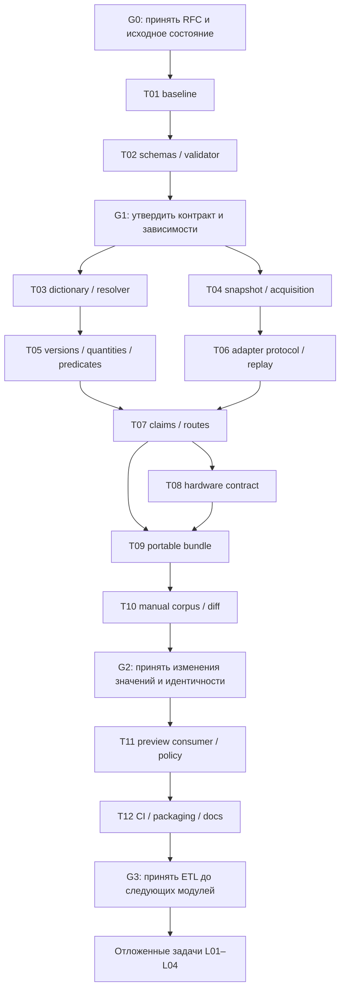

# План реализации архитектурной ревизии

Статус: **утверждён владельцем 16.11.2026**, подготовлен 15.11.2026.
Основание — [RFC](architecture_review_rfc.md). Владелец разрешил принятие правил
и начало реализации; G0 закрыт. Начальная область реализации — T01–T02.
Последующие задачи выполняются по зависимостям и контрольным точкам.
Устные исправления отдельных источников не меняют контракт RFC.

## Состояние на 20.11.2026

| Область | Результат |
|---|---|
| Принятие | RFC и корневой AGENTS.md действуют; AGENTS.md доступен для отслеживания Git. |
| T01 | Реализованы `tools/baseline.py capture/verify`; входы, хеши, первичное происхождение, окружение и прежние full/automatic экспорты фиксируются без сети в новом каталоге. |
| T02 | Реализован независимый `siem.domain`: типы, 5 локальных JSON Schema и `validate_bundle`. |
| T03–T05 | Активен утверждённый словарь v6 (`2026.11.20.6`). Общий resolver сохраняет неизвестные и неоднозначные имена. Версии, величины и условия проверяются локально, включая границы диапазонов EPS. |
| T04/T06 | Снимки проверяются по пути, SHA и media type. Повторное извлечение не обращается к сети и не зависит от кеша или рабочей папки. Текущий манифест содержит 56 записей, 53 из них имеют снимки. Полнота отдельных секций остаётся открытой. |
| T07–T09 | Bundle содержит 1665 утверждений, 25 профилей, 66 требований и 42 локальных снимка. Снимок p05 с ограничением распространения исключён. Поддерживаются `--automatic-only`, проверка целостности, запись ревизии и статус `no_data`. |
| T10/G2 | Владелец принял G2. Политика `preview-coverage/1.1-candidate` совпадает с ручной матрицей в 298/299 ячейках. Пять строк зачтены через `relation_match` с флагом проверки потока. RuSIEM, строка 19, AD DS на Windows Server 2019 — `unknown`, без зачёта до появления доказательства сбора. Результат старого счётчика сохранён в эталоне. |
| T11–T12 | После приёмки G2 интерфейс читает переносимый bundle при его наличии. Добавлены ограничения версий зависимостей, UI extra, коды выхода, фильтр публикации и словарь в пакете. Снимок p05 исключён по SHA. |
| Проверки | На отдельной копии рабочего дерева Windows/Python 3.10.9: 273 теста, 272 успешны, один пропущен из-за отсутствующего локального PDF Ankey. Повторная сборка совпала с контрольным хешем, проверены 299 ячеек G2 и оба маршрута R-Vision в preview. |
| Контрольная точка | Исходный baseline: `architecture_baseline_20261116_01`; актуальный verified: `results/history/architecture_baseline_20261118_01/baseline_manifest.json` (42 документа, 2 known unavailable, без сети). |
| Следующие задачи | Проверка покрытия специализированных секций T06, точности маршрутов T07 и паритета preview T11. Для G3 используется подтверждённый прогон Windows и приёмка владельцем. |

Для G3 локально проверены установка в новом окружении Windows, сборка из
отдельной копии исходников, штатный офлайн-отчёт CI и загрузка wheel вне
репозитория. Повторная сборка дала дайджест
`sha256:dc37c71366248ec189c459f13795ceec8b4911c8200920993416751f05684500`
для проверявшейся тогда сборки. Актуальный эталон хранится в
`tests/fixtures/catalog_v2_semantic_digest.txt`.
Проверка Streamlit `tools/verify_preview.py --bundle results/g3-verify/catalog`
использует тот же переносимый каталог, что и проверка воспроизводимости.
В CI она проверяет все шесть опросников, наличие 13 SIEM и число исходных
строк в деталях каждой организации, а также выбранные доказательства
R-Vision и KOMRAD. В детализации каждый маршрут показан отдельно со
своими посредниками. Проверка «Континента 4» требует привязать внешнюю
БД только к маршруту PostgreSQL. При явно заданном пути к каталогу без
манифеста интерфейс показывает ошибку и не строит таблицы из старой выгрузки.
При замене валидного bundle по тому же пути открытая сессия показывает
данные новой версии при следующем запуске интерфейса. Для запуска нужна зависимость `[ui]`. Публичный артефакт
с текущим реестром разрешений содержит манифест без снимков.
Полный прогон в изолированном окружении Windows с Python 3.10 завершился
успешно: 245 тестов, один пропущен из-за отсутствия необязательного PyMuPDF.
Основной тест таблицы Ankey 5.2.8 на локальном снимке прошёл без PyMuPDF.
Дополнительный просмотр PDF проверен отдельно на Windows/Python 3.10 с
PyMuPDF 1.28.2. Сохранённый PDF Solar SIEM дал 19 кандидатов с номерами страниц
и SHA-256 исходного снимка. Все кандидаты сохранили статус `candidate_for_review`.
Затем проверены эталонный дайджест,
299 ячеек G2 и соответствие входного манифеста аудиту адаптеров.
Локальные артефакты находятся в `results/history/g3_integrated_20261120_02/`.
Следующий полный прогон Windows выполнил 246 тестов, один из которых был
пропущен. Режим переносимой сборки `--automatic-only` проверен отдельным
запуском: штатный загрузчик прочитал 27 автоматически полученных документов,
1484 утверждения и все 13 продуктов SIEM.
Повторная миграция сохраняет дополнительные доказательства из Solar SIEM,
СёрчИнформ SIEM и KOMRAD, когда они привязаны к снимкам манифеста. Они
прикрепляются к утверждению о поддержке, а маршрут сохраняет собственные
доказательства. Аудит актуальной сборки выявил 29 документов с фактами,
11 доступных без фактов и 2 недоступных. Контрольная матрица G2 прошла
проверку с прежними решениями владельца.
Актуальный аудит R-Vision выделяет 13 строк с несколькими пунктами подключения.
При ручной сверке строки WMI/GPO установлено, что WMI — точка входа
коллектора, а GPO — способ настройки WMI на стороне Windows.
Это один способ сбора с разными способами настройки источника.
Оба руководства сохранены с SHA-256 в `results/history/g3_wmi_gpo_review/`.
Аудит отражает этот вывод как ручную сверку с URL и SHA-256. Рабочий каталог
сохраняет один маршрут WMI со ссылкой на снимок инструкции по сбору.
Все 299 дайджестов решений G2 остались прежними.
Для Apache HTTP Server сверка подтвердила два потока access/error через Syslog.
Вводное описание файлов и пример настройки в руководстве расходятся, поэтому
аудит фиксирует потоки без вывода о назначении конкретных путей.
Для Secret Net Studio руководство подтверждает два потока через MS SQL:
аудит сервера безопасности и события защищаемых рабочих станций.
Каталог сохраняет каналы обоих продуктов и отдельный узел-посредник
для каждого маршрута. Все 299 дайджестов G2 сохранились.
Аудит также фиксирует две альтернативы для Linux Auditd (R-Vision Endpoint
и Syslog) и две для Oracle Database (Database и Syslog) по отдельным
руководствам. В каталоге каждый маршрут имеет собственное доказательство.
Варианты пересылки Oracle через rsyslog или syslog-ng описаны руководством,
но не сведены к одному обязательному промежуточному продукту.
Структура списка и цитата сохранены. После сверки руководств шесть из семи
оставшихся строк получили классификацию в [реестре сверок](../data/etl/repro/connection_reviews.json).
Kaspersky Security Center проверен частично. Три руководства R-Vision
подтверждают чтение событий из MS SQL, MySQL (MariaDB) и PostgreSQL и указывают
правило нормализации RV-N-183 для сбора из СУБД. Для Syslog CEF есть запись
в каталоге R-Vision, но охват событий и связь с RV-N-183 неизвестны. Документация
Kaspersky отдельно описывает экспорт CEF и Syslog, а также ограничение CEF
общими событиями управляемых приложений. Это ограничение относится к экспорту
KSC и само по себе не подтверждает распознавание событий в R-Vision.
Аудит сохраняет все четыре пункта и их статус. В отдельной сборке
`results/history/g3_ksc_routes_candidate_20261120` проверены три доказанных
маршрута. Зачёт всех 299 ячеек совпал с текущим, состав доказательств
отличается только у R-Vision в строке 4. По решению владельца KSC остаётся
без уточнения в основном каталоге. Результат сверки доступен в аудите.
У Microsoft SQL Server Database —
способ чтения, SQL Audit — механизм формирования событий. У Citrix и Гарда
NDR способы привязаны к разным потокам. Для PT Application Firewall 3
документированы отдельные потоки поверх Syslog. Для Dallas Lock 8.0 проверены
инструкции чтения БД сервера безопасности и экспорта CEF без утверждения
об эквивалентности потоков. Для ЕЦУ Dallas Lock руководство описывает два
способа сбора. В каталог добавлены оба документированных маршрута ЕЦУ Dallas Lock и единый
Syslog-маршрут PT Application Firewall 3. Различие потоков PT AF 3 пока
сохранено в аудите. Для Citrix и Гарда NDR сформированы отдельные утверждения
с областями сбора по потокам. Связь с транспортом хранится через ссылки
на маршруты. Версия Citrix остаётся неопределённой по каталогу. Для «Континента 4» владелец утвердил два маршрута,
Syslog и PostgreSQL. Каждый связан с собственным снимком руководства. Повторная
сборка воспроизводит утверждённые доказательства двух ячеек R-Vision в G2,
сохраняя зачёт всех 299 сочетаний. Манифест содержит 44 записи, из них 42 снимка.
Адаптер проверяет заголовок и ключевые строки основного текста обоих руководств.
Инструкция PostgreSQL явно требует внешнюю БД. По решению владельца она
моделируется отдельным промежуточным участником маршрута. Зачёт всей матрицы
сохранился, обновились дайджесты двух ячеек R-Vision.
Инструкция Syslog допускает адрес коллектора SIEM или промежуточного Syslog-сервера.
Для KOMRAD из руководства извлекается отдельный
промежуточный шаг Winlogbeat, транспорт HTTP и пять каналов Windows.
Руководство Кибербэкапа подтверждает только канал Application для событий
выполнения планов резервного копирования. Эти различия отображаются в preview.
Среда запуска и приёмки ETL — Windows. Linux и macOS учитываются как
операционные системы источников событий. Их покрытие определяется по
утверждениям о сборе с опубликованными доказательствами.
На Windows офлайн-проверка пройдена с Python 3.10.9 и 3.12.16.
В отдельной копии Windows/Python 3.10.9 прошли 278 из 280 тестов.
Два теста пропущены из-за отсутствия PyMuPDF и локального PDF Ankey.
Отчёты исходной и отдельной копий совпали. Установленный wheel загрузил
перенесённый каталог вне обеих копий. Режим `--automatic-only` содержит
42 документа, полученных через HTTPS, и представляет все 13 SIEM.
GitHub Actions для текущей рабочей копии ещё не запускался.
В текущем каталоге есть отдельные записи `Linux` и `Linux event logs`,
а также `macOS` (R-Vision, версии 10 и 11) и `Mac OS over Syslog`
(RuSIEM, версия не указана). Название `Mac OS X` пока не распознаётся.
Связи между ОС и каналами событий требуют проверки при сопоставлении.

### Документы без утверждений в каталоге

Классификация относится к сохранённым снимкам и двум областям ETL:
поддерживаемым источникам и условиям развёртывания.

| Снимки | Что в них есть | Вывод для ETL |
|---|---|---|
| `p03/architecture`, `p11/docs` | R-Vision перечисляет сценарии подключения со ссылками на руководства. Страница Solar ведёт к отдельному white paper. | Указатели помогают найти документы. Факты извлекаются из соответствующих руководств и PDF. |
| `p04/integration_guide`, `p09/collection`, `p13/versioned_doc` | Alertix описывает Logstash и приём событий. UserGate описывает Syslog, TCP/UDP, TLS и форматы RFC 3164/5424. KOMRAD перечисляет общие протоколы. | Эти сведения подтверждают общие возможности сбора. Для утверждения о конкретном продукте нужен каталог или руководство с его идентификацией. |
| `p04/overview`, `p07/overview` | Общие страницы продуктов. САВРУС публикует показатель более 100 000 EPS без привязки в этом фрагменте к аппаратному профилю и условиям нагрузки. | Показатель из обзора не используется как предел конкретной конфигурации. |
| `p06/sources`, `p06/supported_sources`, `p06/deployment` | HTML-оболочки без видимого содержимого. Для источников используются отдельные сохранённые таблицы. | У этих снимков статус `not_extracted`. Из оболочки развёртывания требования не восстановлены. |
| `p10/release` | Анонс Ankey 5.2.8. Структурированные таблицы разбираются по отдельному PDF при его наличии. | Анонс фиксирует контекст версии. Область поддержки и состав таблиц проверяются по PDF. |
| `p08/compatibility`, `p13/overview` | Для страницы BI.ZONE зафиксирован запрет доступа, для страницы KOMRAD не удалось получить robots.txt. | Статусы `access_disallowed` и `robots_unavailable` учитываются отдельно от результатов разбора. Данные по этим документам неизвестны. |

Сверка с отчётом `results/history/g3_windows_coverage_review_20261120/audit.json`:
После удаления ограниченного PDF 42 документа дают факты, 11 требуют проверки секций, 3 исключены или недоступны.
Среди 11 документов 5 содержат кандидатов на извлечение, 3 имеют пустой
результат и 3 являются HTML-оболочками. Каждый из этих случаев отражён
в таблице выше. Публичный артефакт содержит причины исключения 56 записей
и отчёт проверки. Для приёмки G3 остаются решение владельца и подтверждение
запуска GitHub Actions для этой версии конфигурации.

Проверка миграции словаря v4 → v5 через `tools/build_identity_v5.py --audit`
покрывает 1265 прежних ID. В v5 ключ `Microsoft Windows Server` был неоднозначен:
устаревшие алиасы указывают на отдельные выпуски, а утверждённый алиас —
на семейство. Изолированная проба с перенаправлением старых алиасов изменила
одну ячейку из 299: RuSIEM, AD DS на Windows Server 2019. В зачёт попали
пять строк про более ранние выпуски Windows Server. Миграция теперь отбрасывает
синтетический ключ родительского семейства для утверждения о конкретном
члене, в том числе если его версия явно опубликована. Владелец утвердил v6.
Сравнение v5 и v6 подтвердило одинаковые статусы, зачёт и доказательства
всех 299 ячеек. Технические идентификаторы утверждений изменились. Шесть
дайджестов решений G2 и эталонный хеш каталога обновлены после сверки.
Сравнение доступно через `tools/contract_diff.py --dictionary`.

Текущая сборка `--automatic-only` содержит 41 автоматически полученный
документа, 1486 утверждений и диагностику по всем 13 SIEM. CI проверяет
этот режим на Windows, включая происхождение доказательств двух
маршрутов «Континента 4».

### Что ещё требуется для приёмки

| Критерий G3 | Доказательство и статус |
|---|---|
| Повторная сборка из отдельной копии на Windows | Отчёт `results/history/g3_windows_isolated_20261120/reproducibility.json` совпал с отчётом рабочего дерева. Загрузка перемещённого каталога через установленный wheel прошла вне обеих копий. После изменений T06/T09 контрольный дайджест сохранён в локальной проверке. |
| Все сочетания опросника | В `results/history/g3_windows_coverage_review_20261120/diff.json` ровно 299 уникальных пар (23 × 13). У всех 102 зачтённых пар есть доказательства. Из 197 незачтённых одна имеет доказательство только для компонента (R-Vision, строка 16 опросника), у 196 нет доказательств в проекции. Отсутствие доказательств не означает отсутствие поддержки. Ссылки на утверждения относятся к соответствующей SIEM, ссылки на маршруты разрешаются в том же каталоге. Офлайн-проверка `contract_diff.py --check-candidate` проверяет эти инварианты, уникальность пар и SHA-256 документа для каждого положительного свидетельства. |
| Негативные гарантии | Локально проверены неверный SHA, неподдерживаемая версия схемы, отсутствующий манифест preview и необрабатываемая разметка таблицы. Preview подхватывает новый каталог по тому же пути. |
| Проверка CI и доступность артефакта | Шаги офлайн-проверки, упаковки и preview прошли локально. Для текущих незакоммиченных изменений результат GitHub Actions отсутствует. Публичный пакет содержит отчёт и манифест, а для повторного извлечения нужны локальные снимки. |
| Решение G3 | Владелец оставил G3 открытым. |


| Задачи | Результат и открытая проверка |
|---|---|
| T03–T05 | Общий resolver обслуживает v2 и опросник. Legacy работает через слой совместимости. Контрольный корпус проверяет неоднозначные имена, единицы и границы применимости. |
| T06 | Аудит сопоставляет факты и снимки по SHA-256. Зарегистрированные парсеры источников, аппаратных профилей и требований отдают результаты через общий протокол. Прежний каталог используется как слой совместимости. Полнота отдельных разделов остаётся открытой. |
| T07 | В v2 сохраняются все связанные доказательства, каналы, ограничения и явные отрицательные утверждения. Конфликты с одинаковой зафиксированной областью покрыты контрольным примером. В аудите R-Vision открыта одна строка Kaspersky Security Center. По решению владельца основной каталог сохраняет опубликованное описание строки. Из остальных строк четыре имеют отдельные маршруты в bundle, восемь имеют классификацию способов или потоков в аудите. |
| T08–T09 | Переносимый каталог содержит 25 профилей и 66 требований. Для правил сохранены опубликованные компонент, сценарий и область в типизированных расширениях с доказательствами. Эти строки служат контекстом для будущего сопоставления. Автоматическую применимость определяют структурированные условия. На Windows проверены контрольный хеш, отказ при ошибках чтения снимков и загрузка без пересборки. |
| T10–T11 | G2 принят. Сопоставление v2 доступно в интерфейсе и сохраняет доказательства по каждому утверждению. Историческая загрузка остаётся доступной через адаптер совместимости в ETL. |
| T12/G3 | Офлайн-воспроизведение на Windows подтверждено. Владелец оставил G3 открытым. CI добавляет к публичному артефакту `reproducibility.json` с платформой, ревизией, хешем и сводками проверок. Публичный набор снимков ограничен разрешениями и пока не обеспечивает полное воспроизведение. |

Для запуска без коммита `source_revision` содержит отпечаток исходников и
схем пакета, инструментов сборки и конфигурации зависимостей. Отпечаток
учитывает пути и содержимое с нормализацией LF. Входные манифесты и снимки
по-прежнему проверяются по исходным байтам. CI указывает Git SHA, а поле
`source_digest` сохраняет тот же отпечаток исходников для сравнения с локальной копией.
Сводка `reproducibility.json` также содержит отпечатки опросника, ручного
эталона и реестра решений G2. Их можно сравнить между прогонами без передачи
содержимого опросника.

Владелец сохранил действующую схему требований без оператора `contains_all`.
Требование R-Vision об обеих инструкциях AVX и AVX2 сохраняется в текущей
выгрузке текстом со ссылкой на документацию. Для будущей автоматической
оценки применение этого правила требует отдельного решения о семантике.

Ограничение T07: `unspecified_published_route` используется как маркер
публикации продукта без данных о транспорте и топологии. В проверенной
сборке таких маршрутов 972. Маркер не подтверждает прямой маршрут,
промежуточный продукт или возможность нормализации. Для строгого сценария
эти детали следует считать неизвестными.
На Windows из корня переданной копии рабочего дерева выполнить:

```text
python -m pip install -c constraints.txt -e .
python -m unittest discover -s tests -q
python -m siem.etl check --etl data/etl/repro/vendors.json --automatic-only --output-dir results/g3-repro --no-tests
python tools/verify_reproducibility.py --output-dir results/g3-verify
```

Для приёмки сверить дайджест из манифеста с
`tests/fixtures/catalog_v2_semantic_digest.txt` и приложить версии ОС/Python,
коды выхода, сводки матрицы G2 и аудита. Контрольная матрица допускает одно
зафиксированное расхождение по AD DS на Windows Server 2019 у RuSIEM.
Полный отчёт матрицы G2 формируется командой `tools/contract_diff.py --bundle
... --policy preview-coverage/1.1-candidate --check-candidate --output ...`.
В нём есть основания и дайджест каждой ячейки. Шесть решений владельца по G2
привязаны к дайджестам в `tests/fixtures/g2_owner_decisions.json`.
Для остальных ячеек сохраняется независимый ручной эталон сравнения.
Часть специализированного разбора выполняется через прежние
адаптеры внутри producer; покрытие отдельных секций требует проверки T06.
Аудит по SHA-256 выявил 12 доступных документов без фактов в bundle.
В частности, `p03/architecture`, `p04/integration_guide`, `p09/collection`,
`p10/release`, `p11/architecture` и `p13/versioned_doc` дали лишь фрагменты
для проверки. Ещё шесть документов дали пустой результат общего разбора.
Причину отсутствия фактов нужно устанавливать по каждой целевой секции.
Для трёх HTML-снимков MaxPatrol (`sources`, `supported_sources`, `deployment`)
установлена общая причина: оболочка без видимого содержимого. Адаптер возвращает
`html_shell_without_visible_content`. У источников есть отдельный JSON-каталог.
Таблица R-Vision `architecture` содержит ссылки на аудит и устранение неполадок.
Она не является таблицей источников, версий или аппаратных требований.
Обе таблицы в снимке UserGate `collection` относятся к меню и оглавлению.
В Alertix `integration_guide`, Ankey `release` и KOMRAD `versioned_doc`
видимый материал оформлен прозой. Для этих страниц требуется проверка
конкретных утверждений и их области, прежде чем добавлять структурный адаптер.
В разделе технических характеристик KOMRAD `versioned_doc` перечислены
общие транспорты, форматы и возможности развёртывания. Эти сведения нельзя
зачесть как поддержку конкретного продукта-источника или аппаратный профиль.
HTML-страница Ankey `release` приводит суммарное число типов источников.
Названия отдельных продуктов отнесены к таблицам 3.1 и 3.2 в отдельном PDF
`release_sources`. Для проверки продуктовой поддержки используется этот PDF.
Alertix `integration_guide` описывает общий путь через Logstash и OpenSearch.
Доказательства поддержки конкретных продуктов берутся из таблиц коннекторов.
Solar `docs` направляет к отдельному white paper, а начало страницы
`architecture` описывает возможности платформы. Эти обзорные блоки сами
по себе не задают аппаратных минимумов или версий продуктов-источников.
Отчёт `partial_system_documents.json` фиксирует два ограничения среди
документов, давших факты. Для KUMA разобраны матрица EPS, ОС, базовые агенты
и Kubernetes. Масштабирование метрик, нагрузка агентских коннекторов и
опциональные сервисы остаются вне адаптера. Для Ankey заголовок среднего
профиля указывает два сервера, а перечень содержит три роли. Этот конфликт
требует уточнения схемы размещения и числа физических узлов.
В v2 эти позиции сохранены как логические роли. Профили также сохраняют
физические ядра, логические потоки и vCPU с различными единицами, а для
дисков — документированную ёмкость и RAID. Пороги Ankey сохранены
как непересекающиеся диапазоны: одна полка при 15 000 ≤ EPS < 20 000,
две полки при EPS ≥ 20 000. При неизвестном EPS применимость остаётся
неизвестной. Условия сохранены в контракте для последующего расчёта.
Проверка индекса Git показала три локальных снимка, требуемых текущим входным
манифестом и ещё не входящих в отслеживаемый набор: `p07/compatibility_news`,
`p13/windows_source` и `p13/cyberbackup_scope`. Словарь, схемы и инструменты
сборки также содержат новые неотслеживаемые файлы. Чистый checkout текущего
коммита воспроизводит прежнюю ревизию. Для проверки нового дерева нужна передача
самого дерева и локальных входов в разрешённый контур исполнения.

Доказательства прав на распространение документов не выведены из общего
утверждения архитектуры. Наблюдения фиксируются отдельно по SHA в
`data/etl/repro/permission_observations.json`; разрешение остаётся неизвестным,
пока оно не подтверждено. Существующие снимки и результаты сохранены.

## 1. Объём и последовательность

Минимальный необходимый рефакторинг: T01–T12. Это стабилизация доказательных
данных, идентификации, воспроизведения и существующего preview; новые цена,
строгий подбор и MCDA в него не входят. Ориентир — 20–35 инженерных дней с
проверкой реальных документов, а не обещание времени модели. Сначала требуется
малый вертикальный проход двух SIEM, затем перенос остальных адаптеров.
Каждая задача ниже имеет ограниченную область и отдельный review.



T03/T04 могут выполняться параллельно только разными агентами с непересекающимся
владением файлами. Остальные зависимости соблюдать; «сэкономить» пропуском
проверки корпуса нельзя. Нельзя делать один PR сразу T02–T12: потеряется
возможность независимо принять изменения семантики.

## 2. Интерфейсы, которые исполнитель не проектирует заново

Проектируемые пути, ещё не существующие в текущем коде:

```text
src/siem/domain/           contracts, identity, versions, quantities, conditions
src/siem/etl/snapshots.py  проверка байтов и переносимых путей
src/siem/etl/adapters.py   единая регистрация adapters/purposes
src/siem/etl/bundle.py     построение и чтение нового формата
src/siem/domain/schemas/  JSON Schema, упакованные вместе с библиотекой
src/siem/domain/ontology/            редактируемые сущности, aliases, relations и migration map
```

Публичные функции (имена фиксируются этим планом; существующие CLI сохраняются):

```python
resolve_name(raw_name, context, dictionary) -> Resolution
compare_versions(requested, published_scope, product_scheme) -> VersionFit
compare_quantity(required, available) -> CheckResult
evaluate_conditions(condition, context) -> TruthValue
load_snapshot(document, bundle_root) -> bytes
extract(document, content) -> ExtractionResult
build_bundle(input_manifest, dictionary, options) -> CatalogBundle
load_bundle(bundle_root) -> CatalogBundle
validate_bundle(bundle) -> ValidationResult
project_legacy_coverage(match_trace, policy) -> CoverageProjection
```

Последняя функция принадлежит `decision`, а не ETL. `evaluate_conditions` —
вычисление типизированного предиката, не выбор hardware-профиля; ETL использует
его для self-check, политика подбора остаётся будущему matcher.

Общие enum фиксированы RFC: resolution=`resolved/ambiguous/unresolved`;
assertion=`supported/unsupported/unknown`; capability=`export/collect/normalize/respond`;
extent=`full/subset/unspecified`; TruthValue=`true/false/unknown`;
version fit=`match/mismatch/unknown/not_requested`;
review=`extracted/reviewed/experiment_verified`. ReviewDecision.decision =
`approved/rejected/needs_information`; verified требует отдельного протокола
эксперимента с границами, а не успешного unittest.

Ошибка ValidationResult содержит `code`, JSON-pointer `location`, severity,
target_ref, message. Отсутствие сведений об интеграции не является ошибкой схемы;
утверждение supported без evidence является. Неизвестная грамматика версии
валидна как opaque/unknown, но не сравнивается положительно.

## 3. Контрольные точки владельца

| Gate | Что предъявить владельцу | Условие продолжения |
|---|---|---|
| G0 | RFC, пять главных проблем F01/F03/F04/F06/R03, список исходных изменений, статус разрешений p05/прочих артефактов | Утверждены вариант A и область T01–T02. Решение о публикации закрытых/ограниченных документов не подменяется кодом. |
| G1 | Полные схемы T02, примеры valid/invalid, рекомендуемая зависимость JSON Schema, схема ID и policy/legacy граница | Утверждён контракт до миграции адаптеров. Можно продолжать T03–T10; текущий preview ещё не переключается. |
| G2 | Старый/новый bundle, every-cell diff 23×13, alias migration, потерянные/новые claims и их evidence | Владелец принимает каждое семантическое изменение и новую версию эталона; после этого T11 переключает preview. |
| G3 | Офлайн-воспроизведение из отдельной копии на Windows, проверка CI, полный trace/негативные гарантии, список непроверенных областей | ETL готов как контракт исследования; отдельной задачей разрешаются L01/L02. Не означает готовность к закупочной рекомендации. |

Новый обязательный predicate, изменение единиц/идентичности, скрытое расширение
«поддержки» или новые runtime зависимости вне G1 возвращаются на соответствующий
gate. Исполнитель не выбирает вместо владельца новые значения весов/штрафов.

## 4. Минимальные задачи

### T01. Зафиксировать входы и проверяемую исходную точку

- **Цель/причина:** воспроизводимый baseline при нынешнем грязном дереве, до изменения семантики.
- **Разрешено:** отдельный manifest контрольного корпуса, `tests/fixtures` review metadata и скрипт проверки baseline в dev tooling; документация набора. Существующие снимки/сценарии не переписывать.
- **Сохранить:** все байты, URL/SHA, неизвестные значения, 23 строки листа и старые выгрузки. Не выполнять commit/clean/reset без отдельного запроса.
- **Результат:** manifest с digest каждого входа и текущего исходного дерева, версиями окружения, access/redistribution и способами получения; исходные outputs с IDs/счётчиками и documented missing inputs. Baseline располагается в новом каталоге, не поверх results/history.
- **Тесты:** проверка отсутствующего/изменённого снимка, imported/automatic различаются, replay не считается новой загрузкой. Никакой сети.
- **Приёмка:** другой каталог checkout разрешает те же snapshot refs; перечислены 42 документа и все фактические пути, без придуманной полноты.
- **Зависимости:** G0. **Риск:** принять старый run_at за дату всех документов.
- **Запрещено:** менять ожидаемые результаты ради зелёного теста, удалять дубли, присваивать review по одному hash.

### T02. Реализовать опубликованный контракт и строгую валидацию

- **Цель/причина:** закрыть F01/F02/F07 на границе данных, не маскировать их в UI.
- **Разрешено:** `src/siem/domain/contracts.py`, `domain/schemas/`, новый validator, contract tests; одна согласуемая зависимость в pyproject. Старый validate_catalog пока не заменять.
- **Сохранить:** `focused-siem-etl/1.0` и CLI, текущие алгоритмы/счётчики. Новый контракт versioned рядом со старым.
- **Результат:** полные схемы из RFC, внутренние tagged-типы, ValidationResult и canonical serialization. Схемы — источник правил формы, отдельные функции — для cross-reference/диапазонов/доказательств.
- **Тесты:** missing evidence/hash/id, чужой SIEM, NaN/Infinity, отрицательные CPU/RAM/quantity, EPS min>max, неизвестный comparator, boolean вместо integer, все any/all группы; valid unknown/opaque.
- **Приёмка:** все probes F01/F07 отвергаются до assessment; ReviewDecision проверяет target_digest; схемы не требуют сеть для `$ref`. Пустой dataset допустим только со статусом no_data и диагностикой, а не «готов».
- **Зависимости:** T01. **Риск:** поддерживать разные независимые схемы в Python и JSON.
- **Запрещено:** автозаполнение unknown нулями/false, автоповышение verified, массовый перевод адаптеров до G1.

### T03. Ввести версионируемый справочник и единый resolver

- **Цель/причина:** закрыть F06/R01/R02 без очередного SIEM-specific alias.
- **Разрешено:** `data/ontology`, `domain/identity.py`, отдельный legacy ID map, resolver tests. Старые coverage/identities меняются только через compatibility wrapper после G2.
- **Сохранить:** исходные названия, производители, версии и доказательства. ID назначаются явно, не вычисляются из отображаемого имени.
- **Результат:** dictionary version, Product/Vendor/Alias/Relation, resolve_name и unresolved queue. Перенос каждого нынешнего alias сопровождается решением equivalence/relation/reject и evidence; спорные Switch→MES и KSC/EDR не становятся equivalence.
- **Тесты:** Кибербэкап/Кибер Бэкап/Cyber Backup; vendor Cyberprotect отдельно; 1C/1С, NFKC, Е/Ё, пробелы, C/C++/C#, разные Gateway, alias chains/cycles, конфликт контекста, dictionary update без смены ID.
- **Приёмка:** normalization идемпотентна, все 13 SIEM и пользовательский ввод вызывают одну функцию; неизвестное видно в queue; полная карта old→new IDs и collisions готова для G2.
- **Зависимости:** T02 + G1. **Риск:** смена идентичности без заметного изменения счётчика.
- **Запрещено:** fuzzy/translit positive, alias с условием siem_id, приравнивание family/edition к продукту без подтверждения.

### T04. Объединить получение и проверку снимков

- **Цель/причина:** F02/F10/R08/R09 — одна граница происхождения.
- **Разрешено:** `etl/snapshots.py`, fetcher/pipeline, commands collection/review, acquisition manifest tests. Доступные команды сохраняются через wrappers.
- **Сохранить:** обязательные HTTPS/TLS/robots, размер/redirect limits, исходные URL/время/метод и immutable snapshots. Manual import остаётся manual.
- **Результат:** load_snapshot требует SHA/meta, проверяет путь относительно bundle root и возвращает bytes; acquisition/extraction timestamps разделены; review использует тот же PublicFetcher и manifest. Replay сохраняет исходный acquisition_method.
- **Тесты:** missing/wrong SHA, path traversal/absolute external path, перенос bundle, HTML вместо robots, cross-host redirect, unsupported media, imported replay, parser exception после сохранения байтов.
- **Приёмка:** нет сетевых entrypoints в обход общего компонента; все F02-пробы диагностируются; automatic-only даёт одинаковый охват до/после offline replay.
- **Зависимости:** T02 + G1. **Риск:** потерять совместимость относительных путей старых manifests.
- **Запрещено:** отключать verify, скачивать промежуточные CA без проверки доверия, переписывать исходные snapshot bytes, менять дату получения при replay.

### T05. Объединить версии, единицы и условия

- **Цель/причина:** закрыть F05 и неодинаковые числовые семантики R06.
- **Разрешено:** `domain/versions.py`, `quantities.py`, `conditions.py`, tests; пока без выбора подходящего SIEM/profile.
- **Сохранить:** opaque raw и тип неизвестности; различные release schemes, vCPU/physical/logical, GB/GiB/Gb, raw/usable.
- **Результат:** compare_versions/compare_quantity/evaluate_conditions; schemas all_of/any_of и atoms из RFC. Product-specific version grammar задаётся versioned registry, без скрытого regex в UI.
- **Тесты:** 4≠4.5,6.5≠6.5.7,2008≠2008R2; opaque→unknown; список7/10; диапазоны с включительностью; точка на неизвестной границе; alternative OS+обязательные libs; несовместимые единицы/CPU.
- **Приёмка:** F05 не даёт match; арифметика не делает unknown нулём; неизвестный обязательный predicate не даёт true; преобразование единиц обратимо в пределах утверждённой точности.
- **Зависимости:** T02/T03. **Риск:** заменить все версии глобальным SemVer.
- **Запрещено:** EPS interpolation, physical→vCPU по коэффициенту, угадывание GB как GiB, определение поддержанной версии только из latest URL.

### T06. Ввести единый протокол адаптеров и повторное извлечение

- **Цель/причина:** устранить R03/F08/F09: одинаковые snapshots должны обрабатываться текущими правилами без доверия устаревшим raw facts.
- **Разрешено:** `etl/adapters.py`, extractors, catalog orchestration и adapters по одному; реальные parser tests. Начать с R-Vision таблицы и MaxPatrol API, затем RuSIEM/KUMA/остальные.
- **Сохранить:** все поддержанные структуры и диагностические причины, unit/raw/evidence. Каждый адаптер получает DocumentContext+bytes, не читает произвольные пути.
- **Результат:** ExtractionResult с records/sections/diagnostics/completeness; одна декларация adapter + document purpose. Raw facts становятся проверяемым кешем извлечения, не входом нормализации с независимой семантикой.
- **Тесты:** same-snapshot old-facts tamper не влияет на output; rowspan/colspan/nested/ambiguous cells либо корректны, либо explicit failure; реальные таблицы и версии заголовков; missing optional dependency.
- **Приёмка:** каждый doc из baseline либо обработан адаптером, либо имеет честную причину/section coverage. Частичный разбор R-Vision явно отражён; запись одного факта не делает документ полным.
- **Зависимости:** T02/T04. **Риск:** тихая потеря строки при переносе парсера.
- **Запрещено:** менять aliases/политику в адаптере, считать source_family подтверждённой интеграцией, переводить marketing paragraphs в hardware rules.

Общий табличный адаптер каталогов R-Vision и KUMA отмечает таблицу
со вложенными таблицами или объединёнными ячейками как `not_extracted`.
Причина видна в аудите по номеру таблицы. Такие ячейки нельзя интерпретировать
по позициям обычной строки: сдвиг может присвоить чужую версию или способ
сбора. В сохранённых каталогах обеих систем таких конструкций нет.
Аудит отдельно показывает документы с фактами в bundle и секции, которые
требуют проверки. Наличие факта в bundle не означает полный разбор документа.

### T07. Нормализовать claims/routes без потери семантики

- **Цель/причина:** закрыть F03/F04/R02/R04.
- **Разрешено:** sources, catalog объединение, `domain/contracts` только без смены утверждённой схемы, новый нормализатор claims/routes, tests. Не реализовывать ranking.
- **Сохранить:** явные positive/negative, частичные области, версии, альтернативные маршруты и все evidence; не считать другой вариант документа новой независимой интеграцией.
- **Результат:** stable claim_id/route_id, точное разделение collect/normalize/respond, разрешение сущностей через T03, typed conditions через T05. Merge только семантически одинаковых claims; прочее остаётся alternatives/conflicts.
- **Тесты:** перестановка partial/full, разные ограничения одного имени, fullv1+partialv2, KSC→Syslog, generic Syslog без product proof, конфликт документов, несколько evidence и более3claims.
- **Приёмка:** версия/полнота/ограничения относятся к одному выбранному claim/route; F03 order-dependence отсутствует; публичный JSON не обрезает evidence; unresolved names сохранены.
- **Зависимости:** T03/T05/T06. **Риск:** legacy checksum/hash совпадёт, но область поддержки изменится.
- **Запрещено:** «лучшее из каждого claim», приравнять транспорт к нормализатору, переносить реагирование из факта сбора, скрывать ограничения в human-only note.

### T08. Привести hardware-профили к одной форме

- **Цель/причина:** F08/F09/R06/R07 до применения аппаратных формул.
- **Разрешено:** requirements/storage и аппаратные vendor adapters; profile/unit tests; output projection. Никакого customer hardware solver.
- **Сохранить:** исходные единицы/точность, роли/количество, совместное размещение, EPS basis, необработанные обязательные условия и неизвестное.
- **Результат:** SizingProfile/NodeRequirement/StorageGroup/RequirementClaim из RFC; по каждому ресурсу EvidenceRef; OS alternatives и mandatory dependencies сгруппированы.
- **Тесты:** реальные R-Vision/KUMA/Ankey/KOMRAD/Alertix tuples; raw/per-device/total/usable; unknown disk count; EPS границы; logicalroles vsphysicalnodes; противоречие Ankey сохраняется diagnostic.
- **Приёмка:** 25 старых профилей и 66 доступных для распространения правил имеют объяснимую миграцию; новые поля не выводятся из общих упоминаний; непереводимые профили остаются typed unknown, не выкидываются.
- **Зависимости:** T05/T06/T07. **Риск:** разные CPU units/альтернативы станут одним числом.
- **Запрещено:** автоматически «исправлять» число узлов первоисточника, давать quantity=1 неизвестному диску, переносить product_maxEPS в minimum profile.

### T09. Выпускать переносимый неизменяемый bundle

- **Цель/причина:** R03/R09, воспроизведение вне корня checkout.
- **Разрешено:** `etl/bundle.py`, CLI normalize/check, exports и snapshot references, bundle tests. Старые outputs через versioned projection, не overwrite.
- **Сохранить:** действующие CLI aliases и доступность legacy format; явный выбор automatic-only, сохранение manual provenance.
- **Результат:** CatalogManifest+payload hashes+semantic digest+BuildMetadata, load_bundle/validate_bundle; new output dir, стабильная сортировка, atomic запись после успешной проверки.
- **Тесты:** повторная сборка, input shuffle, другой CWD на Windows, clock change, portable artifact move, payload tamper, неизвестная schema version, отсутствие restricted snapshot.
- **Приёмка:** семантический digest неизменен при эквивалентных входах; ошибки не оставляют каталог, выглядящий готовым; UI/другой модуль может прочитать bundle без vendor adapters/raw facts.
- **Зависимости:** T07/T08. **Риск:** включить built_at/абсолютные пути в semantic hash.
- **Запрещено:** перезаписывать baseline/history, делать единственный timestamp ID набора, считать restricted omissions полностью воспроизводимыми.

### T10. Провести независимую приёмку корпуса и review ledger

- **Цель/причина:** превратить нынешние golden counts в доказательную проверку, не самоподтверждение алгоритма.
- **Разрешено:** corpus review metadata, tests, comparison report/dev command; новый dated review ledger. Пользовательские результаты остаются историческими.
- **Сохранить:** 23 исходные строки, явные решения пользователя о зачёте любой версии/partial, все unavailable причины. Новые ожидаемые значения не генерируются из проверяемого matcher.
- **Результат:** каждый из299 случаев имеет product/claim/route/evidence refs, expected strict outcome и отдельную legacy projection, dictionary/policy versions, reviewer/date/target_digest. Diff old/new с категориями исправления/потеря/новыйфакт/политика.
- **Тесты:** all299, отрицательные controls F01–F08, все13SIEM для общих правил, stale review после смены snapshot/dictionary.
- **Приёмка:** нет необъяснённых изменившихся клеток или потерянных ресурсов; known unavailable остаются unknown; новые semantic decisions предъявлены G2.
- **Зависимости:** T09. **Риск:** переписать test fixture тем же скриптом и получить круговую гарантию.
- **Запрещено:** включать ручной эталон в runtime calculation, объявить299клеток доказательством работы всех реальных интеграций, уравнять unknown сunsupported.

### T11. Переключить существующий preview на контракт и явную policy

- **Цель/причина:** R04/F04/F07/F12, разделение ETL и анализа без нового MCDA.
- **Разрешено:** decision load/assessment/versions facade/ui, app routing только по необходимости, legacy applicability facade. Поведение исторического core не менять.
- **Сохранить:** текущий пользовательский поток и политика preview-coverage/1.0: product anyversion/partial засчитывается с флагами. Всё меняющееся после T10 должно быть утверждено G2.
- **Результат:** UI читает load_bundle, cache по semantic digest; coverage policy version в JSON; source results с полным trace, без смешивания claims. etl.applicability помечен legacy и выведен из нового потока; старые функции доступны через wrapper до отдельной отмены.
- **Тесты:** обновление bundle по тому же пути обновляет UI; missing/extra products.version валидируются одинаково; more-than3claims сохраняются вJSON; WSM/цены не вызываются новым preview; UI показывает source/capability/unknown отдельно.
- **Приёмка:** нет import build_catalog/vendor adapters из аналитики/UI; все299 legacy projections согласованы; собственный EPS модельный origin не становится измерением.
- **Зависимости:** T10 + G2. **Риск:** незаметно поменять значение счётчика при исправлении semantic outcome.
- **Запрещено:** превращать сортировку по документации в рейтинг качества, вводить новые веса/стоимость, развивать анкетный редактор в этой задаче.

### T12. Зафиксировать воспроизведение, CI и эксплуатационную документацию

- **Цель/причина:** F11/F13/R08–R11; передаваемый проект для другого компьютера.
- **Разрешено:** pyproject/locks, CI, CLI exit wrappers, operational docs, tests. Очистка файлов не входит.
- **Сохранить:** Python 3.10+, Windows, offline core без Streamlit/fitz; network job отдельный. Нет требования получить все13SIEM.
- **Результат:** воспроизводимый lock/constraints для проверенного окружения, UI extra, packaging schemas/dictionary, documented clone+bundle mode; exit statuses technical_failed/complete_with_unavailable/no_data; artifact allowlist и provenance.
- **Тесты:** офлайн-проверка на Windows, установка из отдельной копии, запуск из временного каталога и работа без UI/PyMuPDF. Ошибка хеша или разбора даёт ненулевой код выхода. Запрет robots.txt различим с ошибкой разбора. Старые команды сохраняют код выхода.
- **Приёмка:** проверка владельцем на отдельном окружении или CI artifact с полным manifest/snapshots; restricted/unknown документы не публикуются без решения; нет логов «успех» при полном пустом run без причины. README/roadmap и существующие architecture docs согласованы с dataset_id.
- **Зависимости:** T11, G0решение по правам публикации. **Риск:** shell/platform encoding и missing dependencies; запуск проверять инструментально, не количеством тестов.
- **Запрещено:** превращать недоступность внешних сайтов вобязательное падение офлайнCI, безусловноuploadraw, объявлять wheel самодостаточным если datasetнеупакован. После результата — G3.

Повторное извлечение приводит записи SIEM и документов к порядку по ID
до передачи в адаптер совместимости. Регрессионный тест обращает порядок
обоих уровней в полном манифесте и сравнивает весь результат, включая
идентификаторы аппаратных профилей и требований. Контрольный дайджест
основного каталога после исправления совпал с предыдущим. Отдельная проверка
с обратным порядком записей в режиме `--automatic-only` подтвердила
равенство всей выгрузки, включая 41 документ и 1486 утверждений. Загрузчик
отклоняет неподдерживаемую версию схемы до чтения файлов каталога
с ошибкой `bundle_schema_version_unsupported`.

## 5. Отложенные задачи

### L01. Строгое пользовательское сопоставление

- **Цель:** реализовать RequirementResults из RFC после принятого ETL, а не внутри adapters.
- **Разрешено:** отдельный matching service/library и customer requirement validator; currentdecision facade.
- **Сохранить:** CatalogBundle read-only, стабильные refs и legacy policy projection.
- **Результат:** один исход на каждый запрос/SIEM с independent version/scope/condition fits, alternatives, conflicts и trace.
- **Тесты/приёмка:** шесть сценариев RFC, all/any, неизвестные релизы, конфликт supported/unsupported, маршрут KSC без доказанного парсера; полнота продуктовых возможностей не приравнивается к полноте документации.
- **Зависимости:** G3 и отдельное согласование требований модуля. **Риск:** библиотека вырастет в новый независимый справочник. **Запрещено:** новые aliases в matcher, fuzzy-positive, MCDA/цены.

### L02. Аппаратная применимость

- **Цель:** проверять workload/HA/resources по типизированным профилям, не по одному EPS.
- **Разрешено:** matching.hardware и отдельные fixtures; исходные профили не менять.
- **Сохранить:** units, workloadscope и logical/physical placement.
- **Результат:** applicability true/false/unknown; resource fit pass/fail/unknown по каждомуpredicate; необоснованный профиль не имеет fit=pass.
- **Тесты/приёмка:** неизвестная включительность EPS, разные единицы CPU, raw/usable RAID, альтернативные ОС, совместное размещение и отсутствующие условия retention/search сохраняют unknown, без предположений по умолчанию.
- **Зависимости:** G3/L01. **Риск:** домыслить производительность. **Запрещено:** интерполяция EPS, sizing из лицензии, авторский коэффициент производительности без отдельного входа.

### L03. Критерии/стоимость/MCDA

- **Цель:** проектировать после L01/L02; старыйcore не является готовой реализацией нового контракта.
- **Разрешено:** сначала отдельные требования и versioned criterion mapping, затем новые модули по самостоятельному разрешению.
- **Сохранить:** все факты/доказательства и независимое origin оценок/цен.
- **Результат:** утверждённая политика missing values, eligibility, weights, sensitivity и отдельный ценовой dataset.
- **Тесты/приёмка:** полнота документации не становится качеством SIEM, unknown не штрафуется скрытой константой, result содержит версии правил и ссылки на RequirementResults.
- **Зависимости:** L01/L02 + отдельный gate владельца. **Риск:** наследование коэффициентов 0.45/0.60/0.85. **Запрещено:** менять исторические оценки или считать цены в ETL.

### L04. Очистка и возможная SQLite-проекция

- **Цель:** уменьшить дублирование и сложность только после контрактной миграции.
- **Разрешено:** сначала отчёт групп дублей, ref migration, список кандидатов удаления/архивирования; удаление только отдельной разрешённой задачей.
- **Сохранить:** hashes/snapshots/history/чужие изменения, минимальные реальные fixtures и обязательные тесты.
- **Результат:** общее разрешённое хранилище идентичных байтов, ссылки fixtures, компактная эксплуатационная документация; измерение времени, памяти и задержек запросов до предложения БД.
- **Тесты/приёмка:** baseline bundle и все locators работают после перемещения; старые ссылки разрешаются явно; SQLite вводится только при измеренной необходимости и остаётся производной проекцией bundle.
- **Зависимости:** G3. **Риск:** удалить оригинал, важный для происхождения данных или условий распространения. **Запрещено:** git clean/reset, удаление тестов ради вида продукта, БД/микросервисы без обоснования.

## 6. Шаблон задания исполнительной модели

```text
Задача: Txx из docs/architecture_implementation_plan.md.
Утверждены: перечислить G0/G1/G2; входной dataset/dictionary/policy digest.
Прочитать: RFC указанные разделы + указанные функции и реальные документы.
Изменять только: разрешённые в карточке пути.
Сначала воспроизвести: конкретный дефект/несовпадение из карточки.
Сохранить: указанные интерфейсы, provenance и чужие изменения.
Результат: указанный артефакт/контракт; без новой архитектуры и дополнительных модулей.
Проверить: перечисленные тесты + релевантный межвендорный diff в новом каталоге.
Если для решения требуется изменить утверждённый контракт: представить delta и остановить
именно зависимую часть, закончив независимые проверки. Не добавлять исключение молча.
Финал: причина → изменённые файлы → конкретные гарантии → до/после → ограничения.
Без commit/push/delete/publication, если это отдельно не запрошено.
```

Задача завершена только при выполнении её критериев и наличии reviewable diff.
Успешный unittest, новые счётчики или заполненные карточки сами по себе не
закрывают критерий. Недоступные снимки, skipped tests и unknown predicates
перечисляются отдельно с влиянием на результат.
