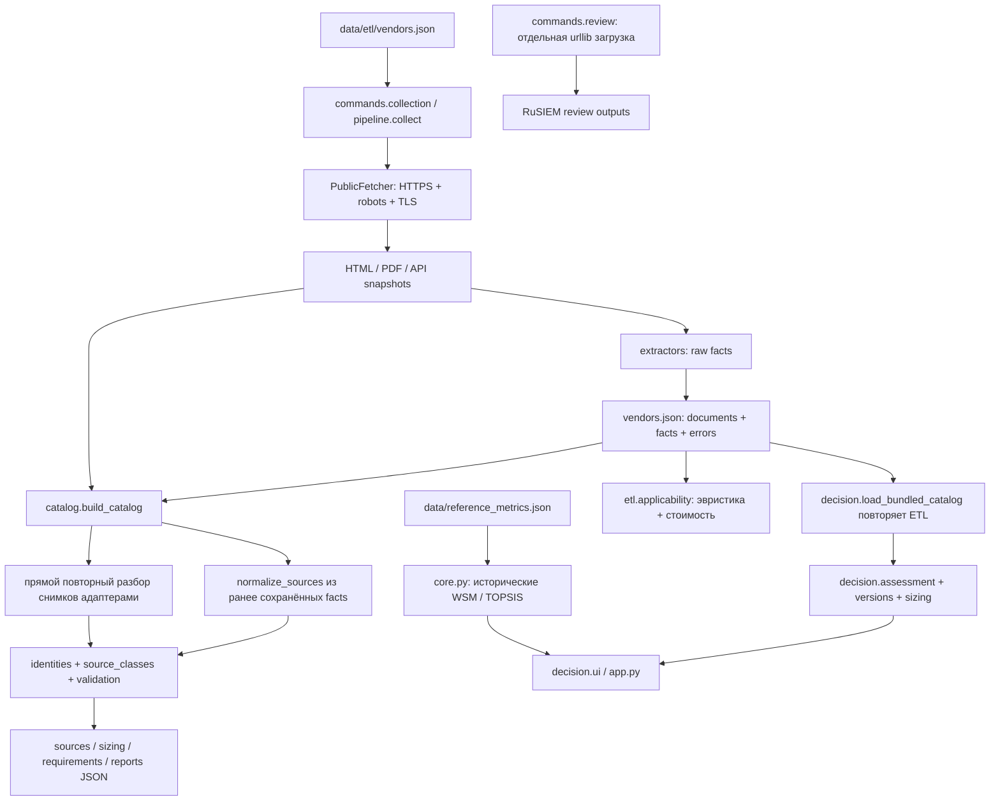
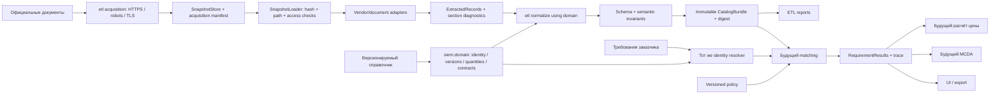

# RFC: доказательный контракт ETL и границы модулей SIEM

Статус: **архитектура утверждена владельцем 16.11.2026**. Ревизия подготовлена
15.11.2026. Это целевой контракт, а не утверждение о завершении его реализации.
Действующая редакция AGENTS.md принята; реализация начинается с T01–T02.

Связанные документы: [план реализации](architecture_implementation_plan.md),
[действующие правила](../AGENTS.md). Этот RFC является
основным источником архитектурных решений. Старые описания сохраняются до отдельной
задачи согласования документации; противоречивые решения из них не наследуются.

## 1. Основание и достоверность ревизии

Проверено рабочее дерево поверх `5e566e9`, а не только HEAD: значительная часть
`decision/`, сценариев и последних исправлений ETL ещё не отслеживается Git.
Исходное удаление LICENSE и чужие изменения остаются за пределами ревизии.
История содержит шесть коммитов от исходного MVP до исправления Windows CLI.
Результат рабочего дерева нельзя объявить воспроизводимым опубликованным релизом.

Прочитаны исходники ETL/decision, исторические core/app, AGENTS, документация,
реестр, workflow, тесты и фактические снимки/выходы. Проверки дефектов выполнялись
в памяти через `python -B`, без записи результатов и без сетевого сбора.
Полный unittest в этой ревизии не запускался: прежний результат 162 теста/1 skip
не является новым подтверждением архитектурных гарантий.

Фактический bundled-набор: 42 записи документов, 40 путей снимков, 1652 утверждения
об источниках, 25 профилей, 67 требований. Из 1652 записей 1473 получены из
документов с `automatic_https`, ещё 179 — из одного импортированного HTML
MaxPatrol. `build_catalog()` сообщает `valid=true`, но ограничения валидатора
рассмотрены ниже. `run_at` набора — 31.10.2026; отдельные документы получены
14.11.2026. Это несколько дат получения, не единый сетевой запуск.

Оценка: полезный исследовательский прототип с сильной базой сохранённых
первоисточников и специализированных адаптеров. Центральные контракты и семантика
ещё недостаточно надёжны для аппаратного допуска и многокритериального выбора.
Дальнейшее расширение UI/рейтинга до стабилизации этого центра увеличивает риск.

## 2. Фактическая архитектура



| Компонент | Фактическая ответственность и зависимость |
|---|---|
| Сбор | [pipeline.collect](../src/siem/etl/pipeline.py#L11) сохраняет байты, хеш, дату, raw facts и ошибки URL. [fetcher.py](../src/siem/etl/fetcher.py#L21) ограничивает TLS, robots, размер и redirect. |
| Извлечение/нормализация | [catalog.build_catalog](../src/siem/etl/catalog.py#L160) одновременно выбирает адаптеры, проверяет снимки, разбирает документы, объединяет утверждения и собирает отчёты. [sources.py](../src/siem/etl/sources.py#L21) читает ранее извлечённые факты; другие адаптеры читают снимки заново. |
| Идентификация | [coverage.canonical](../src/siem/etl/coverage.py#L99), [identities.py](../src/siem/etl/identities.py#L23) и [assessment.py](../src/siem/decision/assessment.py#L36) совместно определяют, что считать одним источником. |
| Валидация | [validate_catalog](../src/siem/etl/validation.py#L9) проверяет часть полей dict, полноценной опубликованной JSON Schema нет. |
| Предварительная аналитика | [assessment.py](../src/siem/decision/assessment.py#L18) пересобирает каталог и применяет политику зачёта, [sizing.py](../src/siem/decision/sizing.py#L10) оценивает EPS по инженерным допущениям. |
| Параллельная аналитика | [etl.applicability.evaluate](../src/siem/etl/applicability.py#L56) содержит другие правила версий, коэффициенты 0.45/0.60/0.85 и стоимость интеграции. Это бизнес-логика внутри ETL. |
| Исторический расчёт | [app.py](../app.py#L6), [core.py](../src/siem/core.py) используют отдельную авторскую таблицу. Это не следующий доказательный модуль MCDA. |
| Распространение | [pyproject.toml](../pyproject.toml) устанавливает `src` и CLI; app/data живут в checkout. Документирован режим clone + editable. SQLite, сервисов, очередей и LLM-парсинга нет. |

## 3. Реестр проблем

Приоритет P1 — исправить до доверенного межмодульного контракта; P2 — до
подключения следующего модуля; P3 — отложенное улучшение. «Дефект» означает
подтверждённое поведение кода; это не всегда повреждение нынешней выгрузки.

### 3.1. Подтверждённые дефекты

| ID | Приоритет, место | Проявление и последствие |
|---|---|---|
| F01 | P1, [validation.py:19](../src/siem/etl/validation.py#L19), :39–78 | Принимаются `evidence=[]`, неизвестный SIEM ID, произвольные review/verification поля. В памяти профиль с отрицательными quantity/vCPU/RAM, EPS 5000→1 и произвольным system requirement получил `valid=true`. Это не свидетельство наличия таких чисел в нынешних 25 профилях; это отсутствие защиты контракта. |
| F02 | P1, [catalog.py:60](../src/siem/etl/catalog.py#L60), :188/:220/:267 | В нескольких путях SHA проверяется только при наличии поля. После удаления хеша аппаратного документа Alertix два профиля приняты с `document_sha256=null`, без unread-диагностики. Разные входные пути обеспечивают разную строгость происхождения. |
| F03 | P1, [sources.py:35](../src/siem/etl/sources.py#L35), :59–70 | Явные входные `support_scope`/`support_limitations` теряются; частичность восстанавливается только regex по описанию. При одинаковом ключе сохраняется описание первого факта, у второго присоединяется лишь evidence. Перестановка «полная/частичная» меняет семантику результата. |
| F04 | P1, [assessment.py:93](../src/siem/decision/assessment.py#L93), :113–126 | Поддержка выбирается из full claims, а версия проверяется по всем claims. На full v1 + partial v2 при запросе v2 получается «версия есть, поддержка полная», evidence указывает только v1. Нельзя собирать положительный результат из несовместимых частей разных утверждений/маршрутов. |
| F05 | P2, [versions.py:26](../src/siem/decision/versions.py#L26), :76–78 | `4` считается найденной версией в `4.5`, `6.5` в `6.5.7`, а Windows Server 2008 совпадает с 2008 R2. Это ложное утверждение о точной версии, даже если политика зачёта разрешает любую версию продукта. |
| F06 | P2, [coverage.py:99](../src/siem/etl/coverage.py#L99) | `Кибербэкап` и `Кибер Бэкап` сейчас различаются. NFKC не применяется, `1Ｃ:ЗУП` отличается от `1C:ЗУП`. Алиас Kaspersky SMG проходит цепочку за два вызова: `canonical(canonical(x)) != canonical(x)`. Реальные ключи зависят от числа нормализаций. |
| F07 | P2, [scenarios.py:76](../src/siem/decision/scenarios.py#L76), [assessment.py:92](../src/siem/decision/assessment.py#L92) | Валидатор разрешает отсутствие version у компонента, assessment читает `item['version']` и падает KeyError. Два алиаса одного продукта допускаются как два разных компонента. |
| F08 | P2, [requirements.py:58](../src/siem/etl/requirements.py#L58) | Общий парсер не проверяет rowspan/colspan/nested tables и молча пропускает неподходящие строки. На таблице с EPS rowspan=2 возвращена только первая конфигурация без диагностики. На текущем реальном R-Vision снимке потеря девяти EPS-строк не обнаружена. |
| F09 | P2, [catalog.py:334](../src/siem/etl/catalog.py#L334), [rvision.py:40](../src/siem/etl/vendors/rvision.py#L40) | Один факт с URL делает документ «обработанным». В реальном R-Vision hardware snapshot есть дополнительные таблицы сателлитов/PostgreSQL, ограничения ОС/ClickHouse и утилит, не покрытые адаптером. Диагностики неполноты по этим разделам нет. «Неразобранные: 0» не означает полного извлечения. |
| F10 | P2, [collection.py:67](../src/siem/etl/commands/collection.py#L67), [pipeline.py:33](../src/siem/etl/pipeline.py#L33) | Replay меняет способ получения на snapshot_replay и дату получения на время нового запуска. Затем automatic-only исключает эти документы. Первичное получение смешано с повторным извлечением. |
| F11 | P2, [collection.py:111](../src/siem/etl/commands/collection.py#L111), [normalization.py:101](../src/siem/etl/commands/normalization.py#L101), [workflow](../.github/workflows/all-vendor-etl.yml) | Полный провал загрузки может завершиться кодом 0; check без тестов не делает run failed по unread/нулевому выходу. Это не критерий технической исправности CI. При этом легальное отсутствие открытой документации не должно становиться обязательным падением всех 13 продуктов. |
| F12 | P2, [ui.py:30](../src/siem/decision/ui.py#L30) | Streamlit кеширует только аргумент path. Изменение содержимого файла/снимков по тому же пути не инвалидирует кеш. Пользователь может видеть старый результат после исправления данных. |
| F13 | P2, [focused_cli.py:5](../src/siem/etl/focused_cli.py#L5) | Legacy entrypoint не передаёт код `main()` через sys.exit. Ошибка проверки может потеряться на уровне процесса. |

### 3.2. Архитектурные риски

| ID | Место | Риск и граница доказанного |
|---|---|---|
| R01 | [identities.py:18](../src/siem/etl/identities.py#L18), [coverage.py:102](../src/siem/etl/coverage.py#L102) | ID строится из имени без производителя; разные Gateway получают один ключ. Удаление пунктуации сводит C++, C# и C к `c`. Коллизия функции подтверждена; реальная такая коллизия в нынешнем каталоге не установлена. Добавление alias может менять уже выданные ID. |
| R02 | [coverage.py:67](../src/siem/etl/coverage.py#L67), :73–80, [identities.py:47](../src/siem/etl/identities.py#L47) | Класс Eltex Switch приравнен линейке MES, журналы 1С — платформе, общий Windows collector — продукту ОС. Скобки могут содержать ограничение, но дают укороченный положительный ключ. Это отношения/области, а не тождественность имён. |
| R03 | [catalog.validated_source_facts](../src/siem/etl/catalog.py#L103) | Хеш снимка не доказывает правильность сохранённого факта. Изменённые value/excerpt с тем же doc hash принимаются; evidence_sha256 не перепроверяется. Нужен повторный разбор снимков и идентификация версии extractor. Это разрыв происхождения/защиты от случайных правок, не вывод о сетевой уязвимости. |
| R04 | [assessment.py:160](../src/siem/decision/assessment.py#L160) | Выход обрезает claims до трёх и берёт первое evidence; теряет SHA, дату, стабильную ссылку на claim. Для MCDA нельзя восстановить полный trace, альтернативы и конфликты. UI может показывать три, публичный JSON должен хранить всё. |
| R05 | [assessment.py:170](../src/siem/decision/assessment.py#L170) | Проверяется интервал EPS, не HA/ОС/ресурсы/границы интервала/нагрузочные условия. Пока это честно подписанный поиск кандидатов, но его нельзя повысить до аппаратного допуска. |
| R06 | [requirements.py:38](../src/siem/etl/requirements.py#L38), [komrad.py:93](../src/siem/etl/vendors/komrad.py#L93), [kuma.py](../src/siem/etl/vendors/kuma.py), [ankey.py](../src/siem/etl/vendors/ankey.py) | Несколько структур CPU/storage/conditions; не везде сгруппированы альтернативные ОС. Логические роли не равны физическим узлам; `cpu_cores` без уточнения не равен vCPU. Прямое суммирование даёт ложные требования. |
| R07 | [ankey.py:149](../src/siem/etl/vendors/ankey.py#L149), [common.py:28](../src/siem/etl/common.py#L28) | Один обрезанный фрагмент профиля не подтверждает каждое числовое значение узлов. URL+SHA позволяют найти документ, но field-level evidence/locator пока недостаточны. |
| R08 | [review.py:18](../src/siem/etl/commands/review.py#L18) | Второй сетевой путь urllib имеет другие robots/redirect/snapshot гарантии, чем PublicFetcher. Активная команда rusiem его использует. Обещание единой политики доступа не обеспечено всеми entrypoints. |
| R09 | [catalog.py:33](../src/siem/etl/catalog.py#L33), :375, [pipeline.py:42](../src/siem/etl/pipeline.py#L42) | CWD-зависимые пути, единый старый timestamp, нет digest пакета и версии справочника/правил. Перенос CI-артефакта или обновление локального snapshot может не воспроизвести опубликованный результат. |
| R10 | [readiness.py:38](../src/siem/etl/reports/readiness.py#L38), :94 | Список документов по доменам вручную дублирует adapter registry и отстал от p07/p13. `calculation_ready=false` всегда безопасен, но процесс review/допуска не существует. Это характеристика исследовательского набора, не оценка SIEM. |
| R11 | [workflow:38](../.github/workflows/all-vendor-etl.yml#L38), p05 PDF, стр.2 | В PDF Security Capsule есть требование разрешения распространения; у registry нет redistribution-маркера, CI публикует весь bundled raw. Разрешение владельцем не установлено. Нужна проверка прав перед будущей публикацией; настоящая ревизия ничего не публикует и не делает правового вывода. |

### 3.3. Ограничения документации и потенциальные улучшения

- BI.ZONE/Ankey: отсутствие доступного каталога, robots/TLS и непрочитанные PDF
  из [ручного аудита](audits/manual_p08_p09_p10_p11_p13_20261114.md) — ограничения
  получения подтверждения. Из них нельзя выводить неподдержку продукта.
- KUMA дополнительные infrastructure sections, противоречивое число узлов Ankey,
  документация `next/latest` — ограничения области/первоисточника. Их нужно
  моделировать, а не «чинить» догадкой ([catalog.py:200](../src/siem/etl/catalog.py#L200), :295).
- 24 группы идентичных tracked raw/fixture файлов дают около 8.1 MiB дублей.
  Дедупликация — улучшение хранения после миграции ссылок, не срочное удаление.
- Wheel не включает app/data, зависимости диапазонные, UI extra отсутствует
  ([pyproject.toml](../pyproject.toml)). Clone+editable допустим; самостоятельная
  установка wheel и полное совпадение окружения пока не гарантированы.
- [project_architecture.md:104](project_architecture.md#L104) предлагает SQLite
  без измеренной потребности; :129 и [roadmap.md:14](roadmap.md#L14) содержат
  1451 вместо нынешнего состава. [decision_module_architecture.md:123](decision_module_architecture.md#L123)
  всё ещё описывает файловый сервер «на AD». Это дрейф документации.

## 4. Варианты и рекомендуемые решения

| Критерий | A: эволюция с заменой доменного центра | B: новое ядро и массовая перепись компонентов |
|---|---|---|
| Объём | Сохранить адаптеры/CLI/снимки; ввести contracts/resolver/SnapshotLoader, постепенно подключить старые выходы | Новый pipeline, новые адаптеры и UI, импорт всех снимков и тестов заново |
| Риск данных | Параллельные old/new выводы и объяснимый diff по каждому claim | Сложнее отличать исправление семантики от потери факта |
| Сопровождение | Меньше дублирования после удаления старых ветвей по этапам | Временно две полные системы, высокая стоимость повторной верификации |
| Цена миграции | Ориентир 20–35 инженерных дней с review и реальными документами | Ориентир 40–65 дней; доверия к адаптерам это само по себе не добавляет |
| Пригодность | Соответствует размеру: около 4 тыс. строк ETL и менее 1 тыс. decision | Оправдано лишь при доказанной невозможности адаптировать существующие парсеры; сейчас её нет |

**Рекомендация A:** модульное приложение Python, файловый пакет данных,
неизменяемые снимки, общий доменный контракт. Это адресная переработка центра,
а не продолжение накопления алиасов вокруг каждого симптома.

| Решение | Выбор и последствия |
|---|---|
| D01 Хранение | JSON + manifest + snapshots по SHA; без БД/микросервисов. SQLite отложить до измеренных проблем запросов, конкурентного редактирования или времени загрузки. |
| D02 Типизация | Машиночитаемые JSON Schema для внешнего контракта; стандартные dataclasses/Enum для внутренних значений. Одна проверка структуры по схеме + отдельные доменные инварианты, без второго независимого набора правил. |
| D03 Валидатор | Рекомендуется одна библиотека JSON Schema, а не собственный универсальный валидатор. Поддержку Draft 2020-12 описывает [официальная документация jsonschema](https://python-jsonschema.readthedocs.io/en/stable/validate/). Версию закрепить после совместимости Python 3.10. Это обоснованная библиотека проверки F01, не новая инфраструктура; утверждение на G1. Альтернатива stdlib hand-validation уменьшает зависимость, но требует собственного полного тестирования ограничений схемы. |
| D04 Идентификаторы | Стабильные ID из справочника; текущие `source:<canonical text>` сохранять только в legacy adapter. ID не вычислять заново из отображаемого имени. |
| D05 Семантика | Факт поддержки, применимость, review и политика зачёта независимы. Политика «любая версия/partial засчитывается» остаётся в preview до отдельного утверждения её изменения. |
| D06 Парсеры | Вендорная структура → ExtractedRecord; общие сущности, версии, статусы, условия, единицы → domain. Вендорная семантика допускается только как явно документированное правило интерпретации конкретного текста с тестом. |
| D07 Воспроизведение | Нормализация всегда из проверенных снимков; raw facts — результат/кеш извлечения с версией extractor, не независимый источник истины. |
| D08 Миграция | Versioned новый контракт, legacy projection и параллельный diff. Не требовать сохранения ошибочных чисел; каждое изменение 23×13 утверждается по evidence. |
| D09 UI/аналитика | Читают готовый bundle и его digest. Сетевые вызовы и build_catalog из UI исключаются отдельной задачей. |
| D10 Документы | Единственное хранилище технических решений — этот RFC и план; общий AGENTS только принципы. Числовые показатели привязаны к dataset_id, не к словам «ETL готов». |

## 5. Целевые компоненты и зависимости



`domain` не импортирует etl, decision, UI, сеть или файлы приложения. ETL не
импортирует matching, EPS-модель заказчика, цену или MCDA. Существующий decision
остаётся preview/facade; исторический core изолирован как legacy. Перемещение
бизнес-логики etl.applicability выполняется после freeze и проверки совместимости
CLI, без изменения старых коэффициентов под видом рефакторинга.

Adapter получает только `DocumentContext + bytes`, возвращает
`ExtractionResult(records, sections, diagnostics, completeness)`. Он знает
rowspan, PDF coordinates, колонки и смысл явно названного раздела. Он не решает,
что Cyberprotect равен Кибер Бэкап, что любая версия пригодна заказчику или что
наличие Syslog обеспечивает нормализацию. Неподдержанная таблица даёт diagnostic,
а не пустой «успешный» список. Адаптеры выбираются одной registry-таблицей;
reports используют ту же декларацию document purpose, без своего списка ID.

## 6. Канонический контракт

Предлагаемый внешний namespace: `siem-catalog/2.0`; совместимость с текущим
`focused-siem-etl/1.0` обеспечивается projection, а не переименованием полей
на месте. В таблицах ниже каждое перечисленное поле обязательно как ключ;
неизвестное значение разрешено только явно указанным `null/unknown`. Ключи ID —
строки, числовые ресурсы конечны и положительны. UTC-время имеет offset.

### 6.1. Пакет, сущности и происхождение

| Объект | Обязательные поля | Потребитель и инвариант |
|---|---|---|
| CatalogManifest | `schema_version`, `dataset_id`, `content_digest`, `input_document_ids`, `dictionary_version`, `normalizer_version`, `extractor_versions`, `build_options`, `payloads` | Loader/UI/CI/cache. payloads перечисляет relative path + SHA каждого JSON; digest — хеш канонического содержимого без собственного digest и без времени построения. Не зависит от CWD/абсолютных путей. |
| BuildMetadata | `build_id`, `built_at`, `source_revision`, `input_manifests`, `dependency_lock_digest` | Воспроизведение конкретной сборки. Не входит в semantic digest; dirty tree требует content digest исходников вместо притворного commit-only. |
| Vendor | `id`, `display_name` | Resolver различает производителя продукта и производителя SIEM. |
| Product | `id`, `vendor_id`, `display_name`, `kind`, `class_ids` | ETL и пользовательский ввод используют один ID. kind=`product/family`; family не даёт права зачесть child. Класс unknown допустим, не определяется по интеграции. |
| Alias | `id`, `surface`, `normalized_key`, `entity_ref`, `context`, `evidence_refs`, `review_state` | Resolver. Только утверждённое эквивалентное имя; context — производитель продукта/язык, никогда ID SIEM, для которого захотели совпадение. |
| ProductRelation | `from_ref`, `relation`, `to_ref`, `evidence_refs`, `review_state` | Candidate/review: `edition_of`, `member_of`, `renamed_from`, `component_of`. Никакого распространения поддержки по этим рёбрам по умолчанию. |
| Document | `document_id`, `sha256`, `source_url`, `resolved_url`, `acquired_at`, `acquisition_method`, `snapshot_path`, `media_type`, `release_scope`, `redistribution` | SnapshotLoader/reviewer/CI. document_id адресует конкретные байты; URL не уникален во времени. acquisition=`automatic_https/manual_import`; replay не меняет получение. Ограниченный snapshot может отсутствовать в public bundle: обязательна причина и external requirement. |
| Evidence | `evidence_id`, `document_ref`, `locator`, `excerpt`, `excerpt_sha256`, `extraction_method`, `extractor_version` | Reviewer/trace. locator=`html section/table/row`, `pdf page/table/cell` либо explicit document-level. Excerpt проверяем по нормализованному тексту с указанным методом; один quote не обязан содержать весь узел, тогда нужны несколько EvidenceRef. |
| Resolution | `resolution_id`, `raw_name`, `normalized_key`, `status`, `product_ref`, `candidate_refs`, `reason_codes`, `dictionary_version` | Unknown queue/ETL/UI. status=`resolved/ambiguous/unresolved`; product_ref null при двух последних. Кандидат не повышается в продукт автоматически. |

`redistribution=allowed/restricted/unknown` — статус допуска артефакта по
документированному решению, не автоматическая правовая оценка. При unknown
публичный CI по умолчанию исключает байты и показывает неполноту воспроизведения.

### 6.2. Утверждения, маршруты и проверка

| Объект | Обязательные поля | Потребитель и смысл |
|---|---|---|
| SupportClaim | `claim_id`, `siem_product_ref`, `siem_release_scope`, `subject_resolution_ref`, `capability`, `assertion`, `scope`, `route_refs`, `evidence_refs`, `review_state` | Будущий matcher. capability=`export/collect/normalize/respond`; assertion=`supported/unsupported/unknown`. Неизвестная SIEM-version явно сохраняется, URL latest не становится релизом. |
| Scope | `source_version`, `edition`, `hardware_models`, `event_channels`, `extent`, `conditions`, `limitations` | Проверка конкретного запроса. extent=`full/subset/unspecified` относительно описанного набора событий, а не всех функций продукта. Ограничения сохраняют raw-текст и typed predicate при возможном разборе. |
| IntegrationRoute | `route_id`, `subject_ref`, `steps`, `conditions`, `evidence_refs`, `review_state` | Отдельная доказательная цепочка. Каждый step содержит actor_ref/role, operation, transport/format или null, parser_ref или null, source release scope и EvidenceRef. Обязательные hops не могут быть доказаны чужим claim. |
| ReviewDecision | `decision_id`, `target_ref`, `target_digest`, `reviewer`, `reviewed_at`, `decision`, `reason`, `evidence_refs` | Ручная сверка и допуск данных. Отдельный append-only объект: extracted не становится verified от заполнения полей или test pass. При изменении target_digest review устаревает. |
| Diagnostic | `code`, `severity`, `target_ref`, `stage`, `message`, `evidence_refs` | CLI/CI/review queue. code стабилен; message не используется алгоритмом. Unknown name, unsupported layout и source inaccessible различаются. |

Claim ID зависит от стабильных ссылок, scope, route и evidence locator;
точный алгоритм канонического JSON фиксируется в T02. Повторные одинаковые
claims можно объединить, объединив provenance. Разные ограничения, версии и
маршруты не объединяются в один «самый хороший» claim. Порядок входа не влияет
на результат. Явные `supersedes` допустимы только по документированному основанию;
более свежая дата сама по себе не отменяет документ другого релиза.

### 6.3. Ресурсы и условия

| Объект | Обязательные поля | Потребитель и инвариант |
|---|---|---|
| VersionScope | `raw`, `kind`, `scheme`, `values`, `lower`, `upper`, `bounds`, `status` | Resolver/matcher. kind=`unknown/exact/set/range/open`; scheme=`opaque/dotted_numeric/windows_release`. Неизвестную грамматику сохраняем opaque, сравнение даёт unknown. 2008 и 2008 R2 различаются; major не равен полному релизу без product-specific version rule. |
| Condition | `operator`, `operands` | Единая ограниченная AST: `all_of/any_of` для групп; атом `metric + comparator + typed_value + subject_ref`. Сравнения `eq/in/gte/lte/range` с единицей. Неподдержанная обязательная AST → unknown, не true. Произвольный Python/вычисляемые строки запрещены. |
| Quantity | `value`, `unit`, `basis`, `raw` | Сравнение ресурсов. value null означает неизвестное; basis=`total/per_node/per_device/physical/logical/unspecified` по свойству. CPU unit различает physical_cores/vCPU/logical_threads/cores_unspecified. GB/GiB/Gb/Gbit/s не смешиваются. |
| SizingProfile | `profile_id`, `siem_product_ref`, `release_scope`, `deployment_scenario`, `tier`, `workload`, `conditions`, `nodes`, `evidence_refs`, `review_state` | Hardware matcher. workload включает EPS с включительностью границ и basis=`technical_sizing/licensed/product_max/unknown`. Неизвестные search/retention/event_size остаются unknown, не назначаются константами. |
| NodeRequirement | `node_ref`, `roles`, `quantity`, `placement`, `cpu`, `ram`, `storage_groups`, `network`, `os_constraints`, `dependency_constraints`, `evidence_refs` | Hardware matcher. quantity содержит exact/minimum/unknown. placement различает physical_node/logical_role и допустимое совместное размещение. Нельзя суммировать все роли как физические серверы. |
| StorageGroup | `purpose`, `quantity`, `per_device_capacity`, `total_capacity`, `capacity_basis`, `medium`, `raid`, `conditions`, `raw`, `evidence_refs` | Проверка хранения. capacity_basis=`raw/usable/effective/unspecified`; quantity null не превращается в1. Не выводить ёмкость одного диска из общего объёма и наоборот при неизвестной топологии. |
| RequirementClaim | `requirement_id`, `siem_product_ref`, `release_scope`, `subject_ref`, `property`, `operator`, `typed_value`, `strength`, `conditions`, `evidence_refs`, `review_state` | Hardware/deployment matcher: mandatory/recommended/supported_option. Альтернативные ОС через any_of, совместно обязательные библиотеки через all_of. |

Внутри Quantity `value` допускает scalar или interval, но форма строго tagged:
число с unit не заменяется строкой «16–32 GB». Сравнение несопоставимых CPU,
неизвестной полезной RAID-ёмкости и разных оснований EPS возвращает unknown.
Переводы единиц выполняются только по фиксированной таблице с сохранением raw.

Дополнительные свойства: один `extensions`-список `key/type/value/unit/evidence_refs`.
Ключи зарегистрированы в versioned extension registry; типы: boolean, enum,
string, quantity, version_scope. Неизвестное extension можно показать, но нельзя
учесть в допуске; неизвестное обязательное условие делает допуск unknown.
Это не неограниченный dict «что угодно» и не отдельный top-level флаг для каждого сайта.

Форма Condition фиксируется без выбора исполнителем: для `all_of/any_of`
operands — массив Condition; для `eq/in/gte/lte/range` operands — объект
`metric/subject_ref/value`, где value — типизированное значение. Например:
`{"operator":"gte","operands":{"metric":"eps","subject_ref":"deployment:main","value":{"value":2500,"unit":"EPS","basis":"total","raw":"2500 EPS"}}}`.
`conditions=null` означает, что условия не установлены. Пустой all_of допускается
только как явное утверждение безусловной применимости с evidence, а не как
автоматическая замена пропущенного текста; пустой any_of не допускается.
`evaluate_conditions(null)` возвращает unknown. Для документов с неизвестной
семантикой ограничений сохраняется raw и diagnostic, без выполнения строки.

### 6.4. Минимальный пример факта и результата

Фрагмент нового payload (ID иллюстративные, не реальные доказательства):

```json
{
  "claim_id": "claim:example-backup-normalizer",
  "siem_product_ref": "siem:example",
  "siem_release_scope": {"raw": null, "kind": "unknown", "scheme": "opaque", "values": [], "lower": null, "upper": null, "bounds": null, "status": "unknown"},
  "subject_resolution_ref": "resolution:cyber-backup-name",
  "capability": "normalize",
  "assertion": "supported",
  "scope": {
    "source_version": {"raw": "15", "kind": "exact", "scheme": "dotted_numeric", "values": ["15"], "lower": null, "upper": null, "bounds": null, "status": "parsed"},
    "edition": null, "hardware_models": [], "event_channels": ["backup_plan"],
    "extent": "subset", "conditions": {"operator": "all_of", "operands": []},
    "limitations": ["Only backup-plan events"]
  },
  "route_refs": ["route:backup-wmi"], "evidence_refs": ["evidence:table-row"],
  "review_state": "extracted"
}
```

Будущий matcher, а не ETL, выдаёт:

```json
{
  "requirement_ref": "req:backup-all-events", "siem_product_ref": "siem:example",
  "catalog_digest": "sha256:...", "dictionary_version": "1.0", "policy_version": "preview-coverage/1.0",
  "outcome": "unknown", "identity_status": "resolved", "version_fit": "match",
  "applicability": "unknown", "confirmed_extent": "subset",
  "selected_claim_refs": ["claim:example-backup-normalizer"], "alternative_claim_refs": [],
  "route_refs": ["route:backup-wmi"], "reason_codes": ["required_event_scope_not_proven"],
  "legacy_coverage": {"counted": true, "partial_support": true},
  "evidence_refs": ["evidence:table-row"]
}
```

Outcome unknown относится к требованию **всех** событий; положительный claim
подтверждает свой subset. Счётчик legacy считает наличие продукта по утверждённой
политике и не подменяет этот результат. Полные JSON Schema и complete fixtures
создаются по этому контракту отдельной задачей T02, не настоящим RFC.

## 7. Детерминированная идентификация

Алгоритм `resolve(raw, product_vendor_context, dictionary_revision)` един для
адаптеров и пользовательского ввода:

1. Сохранить raw; применить Unicode NFKC, casefold, явную политику пробелов и
   типографских тире/кавычек. Е/Ё может создавать поисковый ключ, но не стирать
   raw. Не удалять значимые `+/#` и не выполнять глобальный транслит.
2. Создать ключ формы написания. Латинская C/кириллическая С заменяется только
   в зарегистрированном имени 1С; произвольные омоглифы дают диагностику.
3. Найти утверждённые aliases и canonical names в контексте производителя.
   Ровно одна сущность → resolved; несколько → ambiguous; ни одной → unresolved.
4. Версию/редакцию/модель разобрать отдельно только по известной грамматике
   продукта или структурным полям документа. В противном случае сохранить raw
   и кандидатов. Не отрезать любую цифру и скобку ради положительного совпадения.
5. Для неизвестного имени записать unresolved record со всеми встречаемостями,
   SIEM/doc refs и причиной. Fuzzy/translit можно использовать для упорядочения
   кандидатов при review, но не для автоматического положительного результата.

Проверяемые инварианты: N(N(x))=N(x); все эквивалентные aliases ведут к одному
стабильному ID; один ключ без контекста не ведёт молча к двум продуктам; обновление
словаря не переименовывает ID. Слияние/разделение сущности требует migration map,
review и diff всех затронутых SIEM. Исторические названия получают evidence и,
если необходимо, период/версионную область. Нельзя приравнять производителя
Cyberprotect его продукту Cyber Backup или Комплексную автоматизацию к ERP.

## 8. Поддержка, маршруты и единый результат

Значения относятся к capability + subject + scope + release:

- `supported`: есть явное положительное утверждение первоисточника в этой области.
  Оно остаётся extracted, пока review/эксперимент не подтверждены отдельно.
- `unsupported`: есть явное отрицательное утверждение в этой же области.
  Пустой список, другой релиз, robots и отсутствие парсера в таблице этого не доказывают.
- `unknown`: применимого утверждения нет, не разрешена идентичность/область,
  не вычислено условие либо есть неразрешённый конфликт.

| Основание | Что допустимо подтвердить | Что остаётся unknown |
|---|---|---|
| Прямой нормализатор с названным продуктом/событиями | normalize в явно указанной области; collect, если документирован путь | respond и неперечисленные события |
| EDR → KSC → Syslog → SIEM | Каждый документированный hop и заданный event subset | End-to-end normalize, если не подтверждено соответствие экспортируемых EDR-событий парсеру KSC; respond без команды/документа |
| SIEM принимает произвольный Syslog | collect транспорта как общая возможность | normalize конкретного D-Link/Kaspersky и поддержка конкретного продукта |
| Есть сбор и нормализация событий | collect/normalize соответствующих событий | Реагирование, если оно явно не документировано |
| В каталоге производитель без продукта | Candidate производителя | Поддержка любого продукта производителя |
| Нет публичной документации | Диагностика доступности | Все продуктовые capability; никаких нулевых «оценок качества» |

Matcher оценивает каждый route/claim целиком: identity, version, edition/model,
scope, conditions. Альтернативы независимы: положительный маршрут не может
заимствовать версию/полноту у другого. При all-of все необходимые компоненты
должны удовлетворять требованию; при any-of достаточно одного подходящего.
Unknown в all-of не становится true. Явный конфликт в одной области → unknown
с diagnostic conflicting_claims; конфликт сохраняется в trace.

Текущая политика пользователя сохраняется как `preview-coverage/1.0`:
присутствующий конкретный продукт любой версии и partial включается в счётчик,
а version mismatch и partial остаются признаками. Эта политика не повышает
строгий outcome запроса нужной версии/всех событий до supported. При миграции
каждый новый подсчёт сравнивается с ручной матрицей, изменение политики требует G2.

## 9. Пользовательские сценарии будущего контракта

| Сценарий и вход | Обработка | Выход и неопределённость |
|---|---|---|
| «Кибербэкап», «Кибер Бэкап», документированный Cyber Backup | NFKC/пробелы → три reviewed aliases → `product:cyberprotect.cyber-backup` → один набор claims | Одинаковые результаты для всех 13 SIEM. Cyberprotect без названия продукта даёт vendor candidate; отсутствие alias даёт unresolved с diagnostic, а не пропуск. |
| Один источник у всех 13, версия16, канал audit | Resolve один раз; для каждого siem_ref отобрать claims, оценить release/route/scope, вернуть запись даже при пустом каталоге | Массив ровно13 результатов, evidence и reasons у каждого; неизвестные безусловно присутствуют. Отсутствие документа отдельно от отрицательной поддержки. |
| EDR Optimum, события threat_detection, промежуточный KSC | Идентифицировать конкретную редакцию; найти документированный экспорт subset и приём/парсер SIEM; проверить всю цепь | KSC parser не переименовывается в EDR. Пока соответствие событий не доказано — end-to-end unknown; подтверждённые hops сохраняются. Непонятная версия15.4.266 → identity/scope review. |
| У вендора закрыта документация | Acquisition хранит access_disallowed/robots_unavailable; bundle сохраняет диагностику, но не выдумывает claim | unknown/no_public_evidence. Это не 0% качества и не unsupported. Приватный snapshot при разрешённом локальном использовании не публикуется в CI. |
| Обновился URL latest или релиз SIEM | Новые байты → новый document_id; новый build/dictionary revision; старый dataset остаётся; пересчитать claims и semantic diff | Added/removed/changed/conflicting claims, stale reviews. Старый результат воспроизводится старым bundle; нельзя автоматически перенести поддержку на новый релиз. |
| Нагрузка2500EPS, retention90d, HA=true; 2 сервера по16vCPU/64GiB | Отобрать технические profiles, проверить release, EPS bounds, workload/HA и placement; затем ресурсы каждого узла | applicability=true/false/unknown и fit=pass/fail/unknown по каждому ограничению. Если профиль указывает physical cores, доступны только vCPU или retention неизвестен — unknown, без коэффициента пересчёта/интерполяции. |

Для последнего сценария: профиль «до3000EPS» с неизвестной включительностью
границы при запросе ровно3000 не считается доказанно подходящим. Профиль для
licensed EPS не заменяет technical sizing. Наличие 1TB usable RAID нельзя
проверить по 1TB raw. Логические роли можно совместить только при явном placement.
Ни один из этих алгоритмов не реализуется внутри ETL: ETL передаёт факты и predicates.

## 10. Воспроизводимость и критерии CI

- SnapshotStore адресует байты полным SHA-256; manifest-relative пути, запрещены
  выход за корень и произвольная CWD-подстановка. При одинаковом URL и новых
  байтах сохраняется новая версия. Отсутствие файла/хеша — ошибка целостности,
  не пустая успешная нормализация.
- Acquisition и extraction/build — разные записи. Replay сохраняет original
  acquired_at/method и создаёт новый extraction run. Фильтр automatic-only
  относится к первичному получению, не к наличию replay сегодня.
- Один и тот же набор байтов + registry/dictionary + версии адаптеров/нормализатора
  + build options даёт семантически идентичный bundle независимо от порядка
  входа, CWD, ОС и текущего времени. Сортировка массивов определяется схемой;
  JSON не допускает NaN/Infinity; semantic digest не содержит built_at.
- Офлайн CI: фиксированное окружение на Windows, проверка схемы и инвариантов,
  hash/locator checks, reproducibility, негативные probes F01–F08 и 23×13.
  Количество записей — индикатор diff, не доказательство правильности.
- Сетевой CI отдельно от офлайн gate: unreachable/robots/TLS — результат сбора,
  не дефект парсера. Corrupt snapshot, invalid schema, unexpected parser exception
  и нарушение доступа делают техническую проверку failed. Run может быть
  complete_with_unavailable_sources, но не «все успешно» при отсутствии данных.
- Артефакт содержит manifest, разрешённые snapshots, версии/lock/digests,
  нормализованные JSON и diagnostics. Для исключённых snapshots указываются
  причины и область, которую публично воспроизвести нельзя. Права проверяются
  по allowlist, включая p05, до публикации.
- Базовый ETL запускается без UI и PyMuPDF. Требуемый adapter без зависимости
  выдаёт dependency_unavailable; остальные документы продолжают обрабатываться.
  Наличие pypdf не означает выполнение координатного fitz-теста.

## 11. Гарантии тестирования

| Группа | Гарантия / чего она не доказывает |
|---|---|
| JSON Schema + foreign keys + semantic invariants | Нет невалидных чисел, неизвестных операторов, missing evidence и ложного review-повышения. Не доказывает истинность первоисточника. |
| Resolver metamorphic tests | NFKC/case/whitespace aliases стабильны; производители/редакции/значимая пунктуация не сливаются. Не утверждает равенство непроверенных имён. |
| Реальные документы с locator | Сохраняются конкретные клетки, роли, единицы, ограничения и строки поддержанной разметки. Unsupported layout диагностируется. Не утверждает поддержку всех будущих сайтов. |
| Межвендорный corpus diff | Общее исправление проверено на всех затронутых SIEM, нет необъяснённой потери claims. Числа не запрещают обоснованное исправление. |
| Детерминизм | Перестановка входов, повторное построение и другой CWD дают тот же semantic digest. Новое acquired_at при новом сетевом сборе допустимо. |
| 23×13 | Объяснимый результат на контрольном листе; every cell привязана к versioned manual review и scope. Не является универсальным benchmark полноты поддержки всех организаций. |
| Негативные route/version tests | Нельзя смешать fullv1 и partialv2, KSC и EDR, Windows2008 и2008R2, неизвестное и unsupported. |
| Hardware examples | Нельзя заменить physical cores наvCPU, raw наusable, альтернативы ОС насовместные требования, лицензионный EPS наperformance. |

## 12. Чистота проекта и существующие правила

| Категория | Что сохранять / что предложить позже |
|---|---|
| Необходимый код | etl/адаптеры/CLI/domain; current decision preview и legacy core сохраняются до совместимой миграции. Их наличие не даёт ETL права считать стоимость. |
| Документация | Этот RFC/план/предложение AGENTS; существующие etl.md/architecture.md станут краткими operational docs после отдельной задачи. Старые аудиты — датированные основания, не текущая спецификация. |
| Тесты | Контракт, реальные fixtures, отрицательные кейсы и corpus обязательны. Тесты не удаляются ради «чистого пользовательского продукта». |
| Данные воспроизведения | data/etl/repro с проверенными правами/манифестом; tests fixtures могут ссылаться на общие байты по SHA после миграции. |
| Генерируемое | results (~447.6MiB/8735файлов в текущем workspace), __pycache__, build/dist/egg-info не входят в исходный пакет. Старые выгрузки не удаляются этой ревизией. |
| Временное/частное | local_archive (~5.6MiB), data/private, TLS-бандлы в results — локальные материалы; не публиковать автоматически. Политика хранения утверждается владельцем. |
| Кандидаты очистки | Идентичные raw/fixtures, оболочки MaxPatrol безконтента, legacy CLI aliases, противоречащие docs. Сначала manifest/migration/tests, затем отдельный список удалений с основанием и согласием. |
| Установочный пакет | Runtime код, схемы и нужный versioned dictionary; test corpus/dev docs остаются в репозитории разработчика. Dataset может быть отдельным разрешённым bundle, не обязан входить в wheel. |

AGENTS 1.1 уже защищает неизвестные значения, provenance, TLS и чужие изменения.
Но он не закрепляет единый resolver и границу общей семантики; подробные
напоминания про конкретную ошибку KOMRAD и исключение Ankey/MaxPatrol должны
быть тестами/датированными примерами. Требование «минимальные адресные изменения»
без требования найти общий механизм поощряет очередной alias. «Только ETL»
расходится с уже разрешённым preview, а blanket calculation_ready=false не
описывает будущий процесс допуска. Существующий AGENTS игнорируется Git
([.gitignore](../.gitignore)); постоянные правила не гарантированно попадут в
clone. Предлагаемый текст сохраняет общие инварианты, переносит задачи в план
и не включает локальные исключения в качестве архитектуры.

## 13. Границы будущего MCDA

Публичная граница: `CatalogBundle → RequirementResults(policy_version) →
CriterionMatrix(criteria_version) → MCDA(method, weights)`. Цена — отдельный
потребитель проверенных потребностей и отдельного ценового каталога. ETL не
назначает веса, стоимость, штрафы за unknown и готовность к закупке.

| Параметр | Допустимая операция |
|---|---|
| Измеренный EPS одинакового периода/канала | Сумма после устранения перекрытия событий; значение с origin=estimate отдельно от measurement. |
| Подтверждённая RAM/CPU/storage одного deployment | Числовое сравнение после согласования единиц и placement; сумма только при документированно независимых узлах. |
| Количество строк с продуктом | Описательная доля по выбранной политике/деноминатору; не качество SIEM и не процент всех поддержанных событий. |
| supported/partial/unknown, mismatchверсии, reviewсостояние | Только после отдельного опубликованного соответствия критерию; unknown не равен0, partial не имеет универсального веса0.6. |
| Объём открытой документации/число парсеров | Метрика полноты доказательств, не самостоятельная оценка качества продукта. |
| latency/search/retention/performancebenchmarks | Сопоставление только при совпадающих workload/architecture/методике; иначеunknown. |
| Оценка EPS интегратора/затраты на настройку | Сценарные допущения с версией и чувствительностью; не vendor facts. |

Каждый CriterionValue содержит requirement_refs, rule_id/version, value/interval
или unknown и причины, unit, evidence/review refs. Выбор политики missing values,
ограничений допуска и чувствительности утверждается при проектировании MCDA,
а не в настоящем ETL-рефакторинге. Нельзя подменить этот этап уже существующими
0.45/0.60/0.85 из legacy applicability.

## 14. Контрольные точки реализации

G0: принять фактическую базу/классификацию дефектов и проверить допуск публикации
входных документов, прежде всего p05. G1: утвердить D01–D04, контракт v2 и одну
библиотеку JSON Schema. G2: утвердить migration diff сущностей/политики и ручной
матрицы, отдельно сохранив смысл исторического счётчика. G3: принять portable
bundle/CI и только затем разрешить реализацию строгого matching/hardwarefit.
Архитектурные решения утверждены 16.11.2026; проверка конкретных артефактов
реализации по этим контрольным точкам ведётся в плане.

## 15. Принятие и уточнения первой реализации

16.11.2026 владелец утвердил архитектуру, план, новые правила агентов и начало
реализации. Корневой AGENTS.md принят и включён в область отслеживания Git.
T01 фиксирует существующий формат и его известные ограничения; T02 реализует
новый контракт отдельно, без подключения к прежним адаптерам и preview.

При переводе схемы в код закреплены следующие уточнения формы:

- Quantity.value: число, null или tagged interval с `kind=interval`, lower/upper
  и bounds. Bounds допускает null для неизвестной включительности.
- Количество узлов имеет собственный kind exact/minimum/unknown. Для CPU
  альтернативы единиц из прежних документов выражаются через any_of в
  RequirementClaim; одно число не пересчитывается в другую единицу.
- `deployment:main` и `workload:main` — локальные привязки условия к контексту
  родительского профиля/будущего запроса. Это не новые сущности. Ссылки node:*
  обязаны указывать на объявленный узел; продуктовые ссылки проверяются как FK.
- Отсутствующий ограниченный snapshot описывается `snapshot_path=null` и
  `snapshot_omission={reason, external_requirement}`. Такое отсутствие сохраняет
  ограничение воспроизведения и не превращается в разрешение распространения.
- Canonical JSON означает UTF-8, sort_keys, компактные разделители, сохранённый
  порядок массивов и запрет NaN/Infinity. Это не заявление реализации RFC 8785;
  сортировку семантических множеств выполняет нормализатор в T07/T09.
- Evidence ID адресует содержимое доказательства, включая документ, locator,
  фрагмент и версию извлечения. Route ID адресует шаги, условия и EvidenceRef.
  Review-state не входит в их идентичность. Поэтому изменение доказательства
  или маршрута не может скрыться за прежней ссылкой в подтверждённом claim.
  ID производителя, продукта и алиаса остаются назначенными справочником.

Распределение прав на публикацию не выводится из утверждения архитектуры.
Наблюдение о запрете распространения конкретного PDF хранится как review
metadata по хешу документа; письменное разрешение владельца документа остаётся
неподтверждённым. Сами байты не переписываются.
