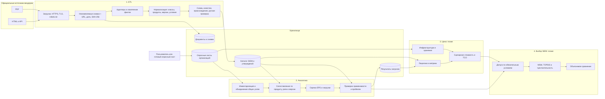
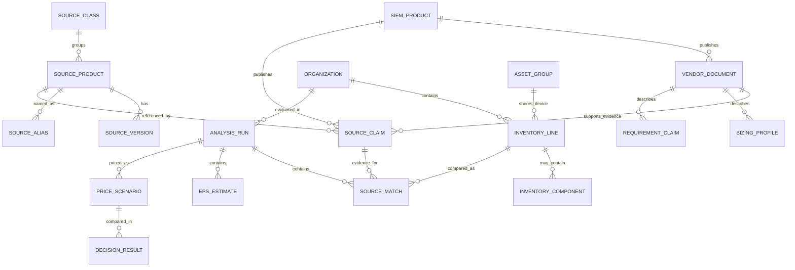

# Архитектура системы сопоставления SIEM

Исторический проект архитектуры. С 16.11.2026 целевые решения определяются
[утверждённым RFC](architecture_review_rfc.md). В частности, SQLite отложена
до измеренной необходимости; счётчики и описания этого старого проекта не
используются как критерии текущей готовности.

## Задача и границы

Система отвечает на вопрос: какие опубликованные возможности SIEM и варианты
развёртывания применимы к инфраструктуре организации, какие сведения ещё нужны
для расчёта, во сколько обойдётся применимое решение и какое из допустимых
решений лучше по выбранным критериям. Каждый вывод должен вести к исходному
документу либо быть явно помечен как пользовательский ввод или инженерная оценка.

На текущем этапе работают ETL и предварительная аналитика сохранённых опросных
листов. Расчёт цены и новый модуль многокритериального выбора не реализованы.
Исторический расчёт в `siem/core.py` не использует новый доказательный контракт.

## Поток данных

Стрелка от аналитики к цене означает передачу **проверенных потребностей**,
а не готового денежного числа. Сведения о ценах, лицензиях и оценках качества
не извлекаются текущим ETL; это отдельные будущие входы с собственной датой и
происхождением. Отсутствующая запись в каталоге означает `unknown`, не
`unsupported`.

## Нормализованная модель данных

Это **целевая логическая схема**, не утверждение, что таблицы БД уже созданы.
Сейчас воспроизводимый ETL хранит исходные снимки и типизированные JSON; пять
учебных организаций и один готовый реальный опросный лист также заданы JSON.
Следующий шаг хранения — SQLite для
локального воспроизведения и проверки научным руководителем. Файлы снимков
остаются отдельными неизменяемыми объектами, БД хранит путь, URL и хеш.
SQLite можно заменить серверной БД без смены идентификаторов и контракта.

### 1. ETL и справочник источников

| Сущность | Обязательные данные | Почему нужны дальше |
| --- | --- | --- |
| `SIEM_PRODUCT` | `siem_id`, название, редакция/версия или `unknown`, область документа | Не смешивать возможности разных продуктов и релизов. |
| `VENDOR_DOCUMENT` | `document_id`, URL, заголовок, дата получения, SHA-256, путь к снимку, версия документа, условия доступа | Проверить каждое утверждение и воспроизвести нормализацию. |
| `SOURCE_CLASS` | `class_id`, название, определение, версия классификатора | Разделить сетевые устройства, ОС, DLP, БД, почту и прочее для опросного листа и анализа. |
| `SOURCE_PRODUCT` | `source_product_id`, производитель, продукт/семейство, класс, статус идентификации | Одна сущность для разных написаний в разных SIEM. Класс не доказывает поддержку продукта. |
| `SOURCE_ALIAS` | исходное написание, продукт, основание связи, статус проверки | Сопоставить `1С`, `1C` и названия вендоров без неявного нечёткого совпадения. |
| `SOURCE_VERSION` | продукт, исходная версия, тип диапазона, нормализованное представление или `unknown` | Различать явно названную версию, диапазон и неопределённость. |
| `SOURCE_CLAIM` | SIEM, продукт-источник, версия/диапазон, роль/компонент, формат и способ сбора, парсер, частичная поддержка, ограничения, доказательство | Базовая единица проверки совместимости; одно название не означает работу всех версий и потоков. |
| `SIZING_PROFILE` | сценарий, EPS и условия, архитектура, роли/число узлов, CPU, RAM, диски, ОС, зависимости, сеть, HA, тип минимума/рекомендации | Сравнить рассчитанную нагрузку и доступные ресурсы с применимым профилем. |
| `REQUIREMENT_CLAIM` | тип требования, значение с единицей, обязательность, условие применения, доказательство | Не терять требования вне таблиц sizing. |

Для каждого утверждения сохраняются короткий фрагмент документа, метод
извлечения, статус проверки и область применимости. Отдельно хранятся исходное
имя и нормализованный идентификатор. `null` не заменяется нулём или отрицанием.
Системный и событийный диск, физические ядра и vCPU, GB и Gb, RAID и полезная
ёмкость — разные поля. EPS профиля относится только к указанной архитектуре.

Текущий каталог уже содержит 1451 утверждение об источниках, 25 профилей
sizing и 67 системных требований. Выход `sources.json` дополнен
`source_class_id` и `source_class_basis`; `source_classes.json` даёт индекс по
классам и идентификаторам продуктов. Автоматическая классификация
консервативна: `unclassified` обозначает очередь редакционной проверки.
Идентификаторы продукта и исходные версии в ETL существовали до этой схемы;
физическая БД и проверенный реестр алиасов всех продуктов ещё не созданы.

### 2. Опросный лист и аналитика

| Группа | Поля и правила |
| --- | --- |
| Организация | `organization_id`, сценарий, дата, число площадок, пользователи и рабочие станции (могут быть неизвестны), сегменты сети, ограничения облака, доступные вычислительные ресурсы. |
| Строка инвентаризации | тип/класс, производитель, продукт, модель, версия ОС или приложения, количество, критичность, обязательность, исходная формулировка. |
| Общий узел | `asset_group_id` связывает DHCP, DNS и AD на одном сервере; `log_stream` различает их журналы. Два потока не превращаются в два физических сервера. |
| Составная строка | компоненты по отдельности (`1С-Бухгалтерия` и `1С-Комплексная автоматизация`); общее количество не распределяется без данных. |
| Нагрузка | средний/пиковый EPS, окно измерения, источник оценки, диапазон неопределённости, резерв, число агентов и хостов, объём событий/день, срок хранения, горячее/холодное хранение. |
| Развёртывание | on-prem/cloud, HA, отказоустойчивость, сеть между площадками, ОС и виртуализация, CPU/RAM/диски. Неизвестное — явное `unknown`. |
| Результат | статус по каждой строке и SIEM (`listed`, `candidate`, `version_conflict`, `unknown`, `unsupported_explicit`), ссылка на утверждение, причина и вопросы для проверки. |

Аналитика сначала определяет **что именно требуется собирать**: например,
журнал ОС Windows, DNS, DHCP и файловый аудит могут находиться на одном узле,
но это разные потоки. Сопоставление проходит по цепочке: точный продукт →
проверенный алиас → компонент/роль → версия и ограничения → способ сбора.
Положительное имя продукта без версии подтверждает только присутствие записи в
каталоге. Родительская категория и общий транспорт остаются кандидатами.

EPS может быть измеренным или сценарной оценкой интегратора. Оценка должна
содержать ставки по классу, количество, допущения, диапазон и запас. Число
пользователей не служит обязательным входом. Нельзя принимать верхнюю
производительность SIEM за sizing минимальной конфигурации. Результат аналитики
содержит матрицу совместимости, покрытие строк, нагрузку, доступные профили,
пробелы доказательств и **статус допуска к следующему модулю**.

### 3. Цена — проектируемый модуль

Цена считается для пары `(организация, SIEM, сценарий развёртывания, период)`.
Нужны тарифная дата и валюта, метрика лицензии (EPS, узел, агент, объём, срок),
ступени, минимальный пакет, запас, цена модулей/коннекторов, техподдержка,
внедрение, требуемые серверы и хранение, их единичные цены, HA и горизонт TCO.
Формула строится из **проверенной структуры тарифа**: затраты на лицензии +
модули + оборудование/облако + внедрение + сопровождение + хранение за период.
Если цена или правило лицензирования неизвестны, возвращается диапазон или
`not_calculable` с причиной; ноль не подставляется. Исторические цены и баллы
не смешиваются с текущими предложениями.

### 4. Выбор SIEM — проектируемый модуль

Сначала выполняется жёсткий допуск: обязательные источники, применимый sizing,
развёртывание, ресурсы и подтверждённые ограничения. Затем допустимые варианты
оцениваются по явно утверждённым критериям: доля подтверждённых интеграций,
доля критичных потоков, запас мощности, стоимость за горизонт, полнота
доказательств, усилия внедрения и ограничения эксплуатации. У каждого критерия
есть направление, единица, нормализация и вес; веса задаются пользователем.
WSM и TOPSIS работают на одной матрице и показывают чувствительность к весам,
цене и неизвестным данным. Неизвестное не приравнивается к нулевому качеству.
Результат хранит вклад критериев, причины исключения, сценарий и версии входов.

## Границы и последовательность реализации

1. Сохранить текущий ETL как воспроизводимый слой утверждений. Расширять
   классификатор по документированным правилам и вручную проверять
   `unclassified`; не менять исходное имя и доказательство.
2. Ввести физическое хранилище и миграцию из JSON в классы, продукты, алиасы,
   версии, утверждения и документы. Сравнить количество и хеши до/после.
3. Закрепить контракт готовых опросных листов и аналитики; на реальном листе
   проверить каждую строку, общие узлы и ограничения версий.
4. Разрабатывать цену только после появления проверяемых тарифных входов.
5. Новый модуль выбора строить на выходах аналитики и цены. Существующий
   исторический расчёт оставить отдельным исследовательским примером.

Критерий готовности аналитики: для каждой строки есть объяснимый статус и
доказательство или явная причина отсутствия; EPS и ресурсы не придуманы;
повторный запуск на сохранённых входах даёт тот же результат. Покрытие каталога
не равно полноте парсеров и не доказывает совместимость конкретной версии.
